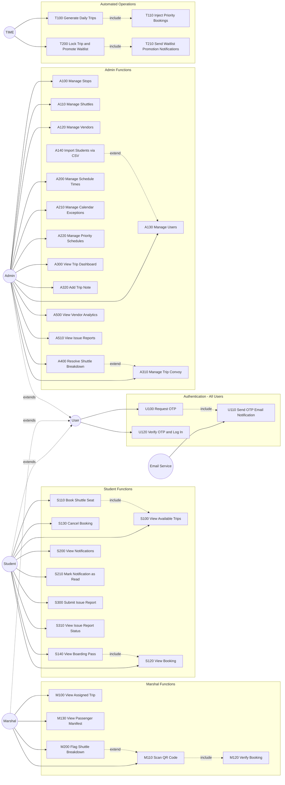

# 2. Functional Requirements & Use Case Modelling

---

## 2.1 Use Case Identification Methodology

Two complementary techniques were applied to identify all use cases:

**User Goal Technique** — Each actor type was analysed for the goals they need to
accomplish when using the system. This surfaced the primary student, marshal, and
admin use cases.

**Event Decomposition Technique** — The system was examined for external events
(user-initiated), temporal events (time-triggered), and state events (internal state
changes). This surfaced the automated background operations that no actor explicitly
invokes.

**Perfect Technology Assumption** — Logout, session management, and database
maintenance are excluded from the use case model as standard technology controls.

**Lecturer-agreed exception — Authentication is included.** In this system,
authentication is not a generic login screen bolted on for security. OTP-based login
is the domain mechanism that verifies university affiliation — only holders of an
active NMU university email address can access the system. The OTP process also
triggers a real domain event: an email is sent to the user's university account.
That email dispatch is a meaningful system response that must be modelled. On the
lecturer's guidance, the authentication group is therefore included in the use case
model under the `U` (User Auth) prefix.

---

## 2.2 Actor Identification

| Actor | Type | Description |
|-------|------|-------------|
| Student | Primary (external) | NMU student. Authenticates via OTP. Books, views, and cancels shuttle trips. Receives notifications. Files reports. |
| Marshal | Primary (external) | NMU field staff. Authenticates via OTP. Scans QR codes at boarding points. Views passenger manifests. Flags shuttle breakdowns. |
| Admin | Primary (external) | NMU system administrator. Authenticates via OTP. Manages all system data and resolves operational incidents. |
| TIME | Temporal (external) | Represents time-based triggers. Drives the nightly trip generation job and the pre-departure lockout gate. |
| Email Service | External system | Azure Communication Services. Receives OTP dispatch requests from the system and delivers the email to the user's NMU inbox. |

> **Note on actor generalisation:** Student, Marshal, and Admin all go through the
> same OTP authentication flow. This shared behaviour is modelled via a `User`
> generalisation — the three role actors inherit from `User`, who owns the auth
> use cases. Each role actor then has its own additional use cases on top.

---

## 2.3 Use Case List by Actor

### User (Authentication — shared by Student, Marshal, Admin)

| ID | Use Case | Event Type |
|----|----------|------------|
| U100 | Request OTP | External |
| U110 | Send OTP Email Notification | State — triggered by U100 |
| U120 | Verify OTP and Log In | External |

> `U100`, `U110`, and `U120` apply equally to Student, Marshal, and Admin.
> All three actors inherit these use cases through the `User` generalisation.
> The `U` prefix groups them separately so it is clear they are cross-cutting
> and not owned by any single role.

### Student

| ID | Use Case | Event Type |
|----|----------|------------|
| S100 | View Available Trips | External |
| S110 | Book Shuttle Seat | External |
| S120 | View Booking | External |
| S130 | Cancel Booking | External |
| S140 | View Boarding Pass | External |
| S200 | View Notifications | External |
| S210 | Mark Notification as Read | External |
| S300 | Submit Issue Report | External |
| S310 | View Issue Report Status | External |

### Marshal

| ID | Use Case | Event Type |
|----|----------|------------|
| M100 | View Assigned Trip | External |
| M110 | Scan QR Code | External |
| M120 | Verify Booking | External — included by M110 |
| M130 | View Passenger Manifest | External |
| M200 | Flag Shuttle Breakdown | External |

### Admin

| ID | Use Case | Event Type |
|----|----------|------------|
| A100 | Manage Stops | External |
| A110 | Manage Shuttles | External |
| A120 | Manage Vendors | External |
| A130 | Manage Users | External |
| A140 | Import Students via CSV | External — extends A130 |
| A200 | Manage Schedule Times | External |
| A210 | Manage Calendar Exceptions | External |
| A220 | Manage Priority Schedules | External |
| A300 | View Trip Dashboard | External |
| A310 | Manage Trip Convoy | External |
| A320 | Add Trip Note | External |
| A400 | Resolve Shuttle Breakdown | External |
| A500 | View Vendor Analytics | External |
| A510 | View Issue Reports | External |

### TIME (Temporal / State)

| ID | Use Case | Event Type |
|----|----------|------------|
| T100 | Generate Daily Trips | Temporal — fires nightly at midnight SAST |
| T110 | Inject Priority Bookings | State — triggered after T100 completes |
| T200 | Lock Trip & Promote Waitlist | Temporal — fires at T-60 min per trip |
| T210 | Send Waitlist Promotion Notifications | State — triggered after T200 |

---

## 2.4 Use Case Diagram

---

## 2.5 Relationship Rationale

| Relationship | Type | Rationale |
|---|---|---|
| U100 → U110 | `<<include>>` | Requesting an OTP always triggers an email dispatch — the email is mandatory, not optional. The system cannot complete OTP request without sending the code to the user's inbox. |
| S110 → S100 | `<<include>>` | A student must view available trips before they can book one. S100 is mandatory to S110. |
| S140 → S120 | `<<include>>` | Viewing the boarding pass is a sub-view of the full booking detail. The booking must be retrieved first. |
| M110 → M120 | `<<include>>` | Scanning a QR code always invokes booking verification — the scan is meaningless without it. |
| A140 → A130 | `<<extend>>` | CSV import is an optional bulk path into user management. Manage Users is complete without it. |
| T100 → T110 | `<<include>>` | Priority booking injection always runs as part of the nightly trip generation cycle, immediately after trips are created. |
| T200 → T210 | `<<include>>` | Sending promotion notifications is a mandatory post-step of the lockout-and-promote operation. |
| M200 → M110 | `<<extend>>` | Flagging a breakdown is an optional action that only occurs if a marshal has identified a problem during the scanning session. Scanning proceeds normally without it. |
| A400 → A310 | `<<extend>>` | Resolving a breakdown is an optional action taken by an admin when they observe a breakdown-flagged trip in the convoy management view. |

---

## 2.6 Use Case Narratives (Fully Developed)

---

### U100 — Request OTP

| Section | Detail |
|---------|--------|
| **Use Case ID** | U100 |
| **Use Case Name** | Request OTP |
| **Business Actors** | User (Student, Marshal, or Admin) |
| **Brief Description** | A user initiates login by submitting their university email address. The system generates a 5-digit one-time password, stores a hashed copy against the account, and triggers an email dispatch (U110) to deliver the code to the user's NMU inbox. |
| **Pre-Conditions** | — The email address submitted belongs to an active account (`IsActive = true`).  — No valid unexpired OTP already exists for this account. |
| **Triggers** | User submits their email address on the login screen and taps "Login." |
| **Post-Conditions** | — A 5-digit OTP is generated and its BCrypt hash stored against the account record.  — `OtpExpiry` is set to 5 minutes from now.  — U110 (Send OTP Email Notification) is executed — the OTP is delivered to the user's inbox. |

**Basic Flow of Events**

| Step | Actor/System | Action |
|------|-------------|--------|
| 1 | User | Opens the login screen and enters their NMU university email address. |
| 2 | User | Taps "Login" / "Request OTP." |
| 3 | System | Looks up the account by email address. |
| 4 | System | Generates a 5-digit numeric OTP code. |
| 5 | System | Hashes the OTP and stores it on the account with a 5-minute expiry. |
| 6 | System | Executes U110 — dispatches the OTP to the user's email via Azure Communication Services. |
| 7 | System | Returns a confirmation that the OTP has been sent. |
| 8 | User | Receives the email and proceeds to U120 (Verify OTP and Log In). |

**Alternate Flow of Events**

| Step | Action |
|------|--------|
| 3.1 | No active account found for the submitted email. System returns a generic "check your email" response (no account enumeration). Flow ends. |
| 6.1 | Email dispatch fails (Azure Comms error). System returns an error. OTP is not stored. User may retry. Flow ends. |

---

### U120 — Verify OTP and Log In

| Section | Detail |
|---------|--------|
| **Use Case ID** | U120 |
| **Use Case Name** | Verify OTP and Log In |
| **Business Actors** | User (Student, Marshal, or Admin) |
| **Brief Description** | The user submits the 5-digit OTP they received by email. The system validates it against the stored hash and expiry, and on success issues a signed JWT that grants access to the role-specific features. |
| **Pre-Conditions** | — U100 has been executed — a hashed OTP and expiry exist on the account.  — The OTP has not yet expired (`OtpExpiry > now`). |
| **Triggers** | User enters the 5-digit code and taps "Confirm OTP." |
| **Post-Conditions** | — OTP hash and expiry cleared from the account record.  — A signed JWT Bearer token is returned, containing the user's ID, role, and expiry.  — User is redirected to the home screen for their role. |

**Basic Flow of Events**

| Step | Actor/System | Action |
|------|-------------|--------|
| 1 | User | Enters the 5-digit OTP received by email. |
| 2 | User | Taps "Confirm OTP." |
| 3 | System | Retrieves the stored OTP hash and expiry for the account. |
| 4 | System | Verifies the submitted code against the BCrypt hash. |
| 5 | System | Clears the OTP hash and expiry from the account. |
| 6 | System | Generates and returns a signed JWT containing the user's ID, role claim, and expiry. |
| 7 | User | JWT is stored on the device. User is navigated to their role home screen. |

**Alternate Flow of Events**

| Step | Action |
|------|--------|
| 3.1 | OTP has expired (`OtpExpiry < now`). System returns HTTP 422. User must restart from U100. Flow ends. |
| 4.1 | OTP code does not match the stored hash. System returns HTTP 422 with an invalid code message. User may retry entry. Return to step 1. |

---

### S110 — Book Shuttle Seat

| Section | Detail |
|---------|--------|
| **Use Case ID** | S110 |
| **Use Case Name** | Book Shuttle Seat |
| **Business Actors** | Student |
| **Brief Description** | A student selects an available trip and reserves a seat. The system either confirms the booking and issues a QR boarding pass, or places the student on the waitlist if the trip is at full capacity. |
| **Pre-Conditions** | — Student is authenticated (valid JWT).  — The selected `TripInstance` exists with `Status = "Scheduling"`.  — The student does not already hold a confirmed or waitlisted booking for that trip. |
| **Triggers** | Student taps "Book" on a trip from the available trips list (S100). |
| **Post-Conditions** | — A `Booking` record is created with `BookingStatus = "Confirmed"` or `"Waitlisted"`.  — A unique `QrCodeToken` is stored against the booking.  — If confirmed, the booking is immediately available for QR viewing (S140). |

**Basic Flow of Events**

| Step | Actor/System | Action |
|------|-------------|--------|
| 1 | Student | Selects a trip from the available trips list. |
| 2 | System | Checks that the trip is in `Scheduling` status. |
| 3 | System | Checks that the student does not already have a booking on this trip. |
| 4 | System | Calculates available seats (total operational shuttle capacity minus confirmed bookings). |
| 5 | System | Creates a `Booking` record with `BookingStatus = "Confirmed"` and a generated `QrCodeToken`. |
| 6 | System | Returns the confirmed booking with QR token to the student. |
| 7 | Student | Views the booking confirmation and QR boarding pass. |

**Alternate Flow of Events**

| Step | Action |
|------|--------|
| 2.1 | Trip `Status` is `"Locked"`, `"InTransit"`, or `"Completed"`. System returns HTTP 400. Flow ends. |
| 3.1 | Student already has a booking on this trip. System returns HTTP 409 Conflict. Flow ends. |
| 4.1 | Available seats = 0. System creates booking with `BookingStatus = "Waitlisted"`. Student is notified they are on the waitlist. Continue to step 6. |

---

### M110 — Scan QR Code

| Section | Detail |
|---------|--------|
| **Use Case ID** | M110 |
| **Use Case Name** | Scan QR Code |
| **Business Actors** | Marshal |
| **Brief Description** | A marshal uses the app camera to scan a student's QR boarding pass at the boarding point. The system validates the token and records the student as boarded, assigning them to a specific shuttle in the convoy. |
| **Pre-Conditions** | — Marshal is authenticated (valid JWT, Marshal role).  — The trip is within 35 minutes of departure (`Status = "Locked"`).  — The student holds a confirmed booking with a valid `QrCodeToken`. |
| **Triggers** | Marshal opens the QR scanner screen and the camera reads a code. |
| **Post-Conditions** | — `Booking.BoardedStatus` updated to `"Boarded"`.  — `Booking.ShuttleId` assigned to the next available shuttle in convoy order.  — `Booking.BoardedAt` timestamp recorded. |

**Basic Flow of Events**

| Step | Actor/System | Action |
|------|-------------|--------|
| 1 | Marshal | Opens QR scanner screen on the mobile app. |
| 2 | Marshal | Points camera at the student's QR code. |
| 3 | System | Reads and extracts the `QrCodeToken` from the QR image. |
| 4 | System | Executes M120 (Verify Booking) — looks up the booking by token, validates trip date and status. |
| 5 | System | Determines the next available shuttle in the convoy (filling from `OrderPosition = 1` upward). |
| 6 | System | Updates `BoardedStatus = "Boarded"`, assigns `ShuttleId`, records `BoardedAt`. |
| 7 | System | Displays a green confirmation with the student's name. |
| 8 | Marshal | Boards the student onto the designated shuttle. |

**Alternate Flow of Events**

| Step | Action |
|------|--------|
| 4.1 | Token not found, booking already boarded, or trip date mismatch. System returns a red rejection response. |
| 4.2 | Marshal taps "Re-Scan". Flow returns to step 1. |
| 5.1 | All shuttles at capacity (edge case at lock time). System returns a rejection message. Flow ends. |

---

### T100 — Generate Daily Trips

| Section | Detail |
|---------|--------|
| **Use Case ID** | T100 |
| **Use Case Name** | Generate Daily Trips |
| **Business Actors** | TIME |
| **Brief Description** | At midnight SAST, the system calculates the date 3 days ahead and creates `TripInstance` records for every matching `ScheduleTime`, then auto-populates convoy allocations from each stop's default shuttle roster. This use case always includes T110. |
| **Pre-Conditions** | — `RollingInjectionService` background process is running.  — No trip instances already exist for the target date (idempotency check). |
| **Triggers** | System clock reaches midnight SAST. |
| **Post-Conditions** | — `TripInstance` records created for target date (skipped if date is Sunday or a `CalendarException`).  — `TripShuttleAllocation` records created from `StopShuttleDefault` roster.  — Priority bookings injected (T110). |

**Basic Flow of Events**

| Step | Actor/System | Action |
|------|-------------|--------|
| 1 | TIME | Midnight SAST timer fires. |
| 2 | System | Calculates target date = today (SAST) + 3 days. |
| 3 | System | Checks `CalendarExceptions` table for the target date. |
| 4 | System | Checks if target date is a Sunday. |
| 5 | System | Determines `ScheduleType` ("Weekday" or "Saturday"). |
| 6 | System | Queries all `ScheduleTimes` matching the `ScheduleType`. |
| 7 | System | Creates a `TripInstance` (Status = "Scheduling") for each `ScheduleTime`. |
| 8 | System | For each new trip, copies `StopShuttleDefault` entries into `TripShuttleAllocation` records. |
| 9 | System | Executes T110 (Inject Priority Bookings) for the target date. |

**Alternate Flow of Events**

| Step | Action |
|------|--------|
| 3.1 | Target date is a `CalendarException` (public holiday or university recess). No trips are created. Flow ends. |
| 4.1 | Target date is a Sunday. No trips are created. Flow ends. |
| 7.1 | Trip already exists for a given `ScheduleTimeId + StopId + TripDate` (idempotency). That trip is skipped; others continue. |

---

### T200 — Lock Trip & Promote Waitlist

| Section | Detail |
|---------|--------|
| **Use Case ID** | T200 |
| **Use Case Name** | Lock Trip and Promote Waitlist |
| **Business Actors** | TIME |
| **Brief Description** | Exactly 60 minutes before each trip's departure, the system locks the trip against further bookings and cancellations, then promotes waitlisted students into confirmed seats in FIFO order. This use case always includes T210. |
| **Pre-Conditions** | — `LockoutGateService` background process is running.  — `TripInstance.Status = "Scheduling"`.  — Departure time is 60 minutes away. |
| **Triggers** | System clock reaches T-60 minutes before a trip's SAST departure time. |
| **Post-Conditions** | — `TripInstance.Status` updated to `"Locked"`, `LockedAt` timestamp recorded.  — Waitlisted bookings promoted to `"Confirmed"` up to available capacity.  — Promoted students receive push notifications (T210). |

**Basic Flow of Events**

| Step | Actor/System | Action |
|------|-------------|--------|
| 1 | TIME | T-60 timer fires for the next scheduled trip. |
| 2 | System | Opens a serialisable database transaction. |
| 3 | System | Re-reads `TripInstance`, confirms `Status = "Scheduling"`. |
| 4 | System | Sets `Status = "Locked"`, records `LockedAt`. |
| 5 | System | Commits transaction. |
| 6 | System | Calculates available capacity (total capacity minus confirmed count). |
| 7 | System | Retrieves waitlisted bookings ordered by `CreatedAt` ascending. |
| 8 | System | Promotes each waitlisted booking to `"Confirmed"` until capacity is filled. |
| 9 | System | Executes T210 (Send Waitlist Promotion Notifications) for all promoted students. |

**Alternate Flow of Events**

| Step | Action |
|------|--------|
| 3.1 | Trip is no longer in `"Scheduling"` state (already locked or cancelled). Transaction is rolled back. Flow ends. |
| 6.1 | Available capacity is 0. No promotions occur. T210 is not called. Flow ends after step 5. |

---

### A400 — Resolve Shuttle Breakdown

| Section | Detail |
|---------|--------|
| **Use Case ID** | A400 |
| **Use Case Name** | Resolve Shuttle Breakdown |
| **Business Actors** | Admin |
| **Brief Description** | An administrator resolves a breakdown that has been flagged by a marshal. The resolution is either a shuttle replacement or a cancellation of that shuttle from the convoy. Push notifications are sent to all affected confirmed passengers after resolution. |
| **Pre-Conditions** | — A `BreakdownLog` record exists with no `ResolvedAt` value.  — The trip is still active (not Completed).  — Admin is authenticated (valid JWT, Admin role). |
| **Triggers** | Admin opens the breakdown resolution panel in the web portal and confirms a resolution action. |
| **Post-Conditions** | — `BreakdownLog.ResolutionType` set to `"Replaced"` or `"Cancelled"`.  — `ResolvedAt` and `ResolvedByAdminId` recorded.  — If replaced: new shuttle added to `TripShuttleAllocation`.  — Push notifications sent to all confirmed booking holders on the trip. |

**Basic Flow of Events**

| Step | Actor/System | Action |
|------|-------------|--------|
| 1 | Admin | Opens trip management view and identifies an unresolved breakdown. |
| 2 | Admin | Selects resolution type: "Replace" or "Cancel". |
| 3 | Admin (Replace path) | Selects a replacement shuttle from the active shuttle pool. |
| 4 | System | Updates `BreakdownLog` with `ResolutionType`, `ReplacementShuttleId`, `ResolvedAt`, `ResolvedByAdminId`. |
| 5 | System | Adds the replacement shuttle to `TripShuttleAllocation`. |
| 6 | System | Sends push notifications via FCM to all confirmed booking holders on the trip. |

**Alternate Flow of Events**

| Step | Action |
|------|--------|
| 2.1 | Admin selects "Cancel" (no replacement). Step 3 and 5 are skipped. The broken shuttle is removed from the convoy. Continue from step 4. |
| 3.1 | Selected replacement shuttle is already allocated to another trip. System rejects the selection. Return to step 3. |
