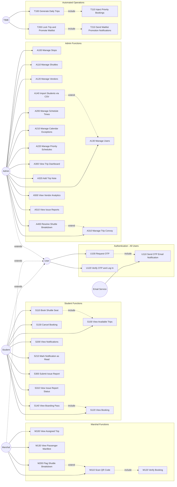

# 2. Functional Requirements & Use Case Modelling

---

## 2.1 Use Case Identification Methodology

Two complementary techniques were applied to identify all use cases:

**User Goal Technique** — Each actor type was analysed for the goals they need to
accomplish when using the system. This surfaced the primary student, marshal, and
admin use cases.

**Event Decomposition Technique** — The system was examined for external events
(user-initiated), temporal events (time-triggered), and state events (internal state
changes). This surfaced the automated background operations that no actor explicitly
invokes.

**Perfect Technology Assumption** — Logout, session management, and database
maintenance are excluded from the use case model as standard technology controls.

**Lecturer-agreed exception — Authentication is included.** In this system,
authentication is not a generic login screen bolted on for security. OTP-based login
is the domain mechanism that verifies university affiliation — only holders of an
active NMU university email address can access the system. The OTP process also
triggers a real domain event: an email is sent to the user's university account.
That email dispatch is a meaningful system response that must be modelled. On the
lecturer's guidance, the authentication group is therefore included in the use case
model under the `U` (User Auth) prefix.

---

## 2.2 Actor Identification

| Actor | Type | Description |
|-------|------|-------------|
| Student | Primary (external) | NMU student. Authenticates via OTP. Books, views, and cancels shuttle trips. Receives notifications. Files reports. |
| Marshal | Primary (external) | NMU field staff. Authenticates via OTP. Scans QR codes at boarding points. Views passenger manifests. Flags shuttle breakdowns. |
| Admin | Primary (external) | NMU system administrator. Authenticates via OTP. Manages all system data and resolves operational incidents. |
| TIME | Temporal (external) | Represents time-based triggers. Drives the nightly trip generation job and the pre-departure lockout gate. |
| Email Service | External system | Azure Communication Services. Receives OTP dispatch requests from the system and delivers the email to the user's NMU inbox. |

> **Note on actor generalisation:** Student, Marshal, and Admin all go through the
> same OTP authentication flow. This shared behaviour is modelled via a `User`
> generalisation — the three role actors inherit from `User`, who owns the auth
> use cases. Each role actor then has its own additional use cases on top.

---

## 2.3 Use Case List by Actor

### User (Authentication — shared by Student, Marshal, Admin)

| ID | Use Case | Event Type |
|----|----------|------------|
| U100 | Request OTP | External |
| U110 | Send OTP Email Notification | State — triggered by U100 |
| U120 | Verify OTP and Log In | External |

> `U100`, `U110`, and `U120` apply equally to Student, Marshal, and Admin.
> All three actors inherit these use cases through the `User` generalisation.
> The `U` prefix groups them separately so it is clear they are cross-cutting
> and not owned by any single role.

### Student

| ID | Use Case | Event Type |
|----|----------|------------|
| S100 | View Available Trips | External |
| S110 | Book Shuttle Seat | External |
| S120 | View Booking | External |
| S130 | Cancel Booking | External |
| S140 | View Boarding Pass | External |
| S200 | View Notifications | External |
| S210 | Mark Notification as Read | External |
| S300 | Submit Issue Report | External |
| S310 | View Issue Report Status | External |

### Marshal

| ID | Use Case | Event Type |
|----|----------|------------|
| M100 | View Assigned Trip | External |
| M110 | Scan QR Code | External |
| M120 | Verify Booking | External — included by M110 |
| M130 | View Passenger Manifest | External |
| M200 | Flag Shuttle Breakdown | External |

### Admin

| ID | Use Case | Event Type |
|----|----------|------------|
| A100 | Manage Stops | External |
| A110 | Manage Shuttles | External |
| A120 | Manage Vendors | External |
| A130 | Manage Users | External |
| A140 | Import Students via CSV | External — extends A130 |
| A200 | Manage Schedule Times | External |
| A210 | Manage Calendar Exceptions | External |
| A220 | Manage Priority Schedules | External |
| A300 | View Trip Dashboard | External |
| A310 | Manage Trip Convoy | External |
| A320 | Add Trip Note | External |
| A400 | Resolve Shuttle Breakdown | External |
| A500 | View Vendor Analytics | External |
| A510 | View Issue Reports | External |

### TIME (Temporal / State)

| ID | Use Case | Event Type |
|----|----------|------------|
| T100 | Generate Daily Trips | Temporal — fires nightly at midnight SAST |
| T110 | Inject Priority Bookings | State — triggered after T100 completes |
| T200 | Lock Trip & Promote Waitlist | Temporal — fires at T-60 min per trip |
| T210 | Send Waitlist Promotion Notifications | State — triggered after T200 |

---

## 2.4 Use Case Diagram

---

## 2.5 Relationship Rationale

| Relationship | Type | Rationale |
|---|---|---|
| U100 → U110 | `<<include>>` | Requesting an OTP always triggers an email dispatch — the email is mandatory, not optional. The system cannot complete OTP request without sending the code to the user's inbox. |
| S110 → S100 | `<<include>>` | A student must view available trips before they can book one. S100 is mandatory to S110. |
| S140 → S120 | `<<include>>` | Viewing the boarding pass is a sub-view of the full booking detail. The booking must be retrieved first. |
| M110 → M120 | `<<include>>` | Scanning a QR code always invokes booking verification — the scan is meaningless without it. |
| A140 → A130 | `<<extend>>` | CSV import is an optional bulk path into user management. Manage Users is complete without it. |
| T100 → T110 | `<<include>>` | Priority booking injection always runs as part of the nightly trip generation cycle, immediately after trips are created. |
| T200 → T210 | `<<include>>` | Sending promotion notifications is a mandatory post-step of the lockout-and-promote operation. |
| M200 → M110 | `<<extend>>` | Flagging a breakdown is an optional action that only occurs if a marshal has identified a problem during the scanning session. Scanning proceeds normally without it. |
| A400 → A310 | `<<extend>>` | Resolving a breakdown is an optional action taken by an admin when they observe a breakdown-flagged trip in the convoy management view. |

---

## 2.6 Use Case Narratives (Fully Developed)

---

### U100 — Request OTP

| Section | Detail |
|---------|--------|
| **Use Case ID** | U100 |
| **Use Case Name** | Request OTP |
| **Business Actors** | User (Student, Marshal, or Admin) |
| **Brief Description** | A user initiates login by submitting their university email address. The system generates a 5-digit one-time password, stores a hashed copy against the account, and triggers an email dispatch (U110) to deliver the code to the user's NMU inbox. |
| **Pre-Conditions** | — The email address submitted belongs to an active account (`IsActive = true`).  — No valid unexpired OTP already exists for this account. |
| **Triggers** | User submits their email address on the login screen and taps "Login." |
| **Post-Conditions** | — A 5-digit OTP is generated and its BCrypt hash stored against the account record.  — `OtpExpiry` is set to 5 minutes from now.  — U110 (Send OTP Email Notification) is executed — the OTP is delivered to the user's inbox. |

**Basic Flow of Events**

| Step | Actor/System | Action |
|------|-------------|--------|
| 1 | User | Opens the login screen and enters their NMU university email address. |
| 2 | User | Taps "Login" / "Request OTP." |
| 3 | System | Looks up the account by email address. |
| 4 | System | Generates a 5-digit numeric OTP code. |
| 5 | System | Hashes the OTP and stores it on the account with a 5-minute expiry. |
| 6 | System | Executes U110 — dispatches the OTP to the user's email via Azure Communication Services. |
| 7 | System | Returns a confirmation that the OTP has been sent. |
| 8 | User | Receives the email and proceeds to U120 (Verify OTP and Log In). |

**Alternate Flow of Events**

| Step | Action |
|------|--------|
| 3.1 | No active account found for the submitted email. System returns a generic "check your email" response (no account enumeration). Flow ends. |
| 6.1 | Email dispatch fails (Azure Comms error). System returns an error. OTP is not stored. User may retry. Flow ends. |

---

### U120 — Verify OTP and Log In

| Section | Detail |
|---------|--------|
| **Use Case ID** | U120 |
| **Use Case Name** | Verify OTP and Log In |
| **Business Actors** | User (Student, Marshal, or Admin) |
| **Brief Description** | The user submits the 5-digit OTP they received by email. The system validates it against the stored hash and expiry, and on success issues a signed JWT that grants access to the role-specific features. |
| **Pre-Conditions** | — U100 has been executed — a hashed OTP and expiry exist on the account.  — The OTP has not yet expired (`OtpExpiry > now`). |
| **Triggers** | User enters the 5-digit code and taps "Confirm OTP." |
| **Post-Conditions** | — OTP hash and expiry cleared from the account record.  — A signed JWT Bearer token is returned, containing the user's ID, role, and expiry.  — User is redirected to the home screen for their role. |

**Basic Flow of Events**

| Step | Actor/System | Action |
|------|-------------|--------|
| 1 | User | Enters the 5-digit OTP received by email. |
| 2 | User | Taps "Confirm OTP." |
| 3 | System | Retrieves the stored OTP hash and expiry for the account. |
| 4 | System | Verifies the submitted code against the BCrypt hash. |
| 5 | System | Clears the OTP hash and expiry from the account. |
| 6 | System | Generates and returns a signed JWT containing the user's ID, role claim, and expiry. |
| 7 | User | JWT is stored on the device. User is navigated to their role home screen. |

**Alternate Flow of Events**

| Step | Action |
|------|--------|
| 3.1 | OTP has expired (`OtpExpiry < now`). System returns HTTP 422. User must restart from U100. Flow ends. |
| 4.1 | OTP code does not match the stored hash. System returns HTTP 422 with an invalid code message. User may retry entry. Return to step 1. |

---

### S110 — Book Shuttle Seat

| Section | Detail |
|---------|--------|
| **Use Case ID** | S110 |
| **Use Case Name** | Book Shuttle Seat |
| **Business Actors** | Student |
| **Brief Description** | A student selects an available trip and reserves a seat. The system either confirms the booking and issues a QR boarding pass, or places the student on the waitlist if the trip is at full capacity. |
| **Pre-Conditions** | — Student is authenticated (valid JWT).  — The selected `TripInstance` exists with `Status = "Scheduling"`.  — The student does not already hold a confirmed or waitlisted booking for that trip. |
| **Triggers** | Student taps "Book" on a trip from the available trips list (S100). |
| **Post-Conditions** | — A `Booking` record is created with `BookingStatus = "Confirmed"` or `"Waitlisted"`.  — A unique `QrCodeToken` is stored against the booking.  — If confirmed, the booking is immediately available for QR viewing (S140). |

**Basic Flow of Events**

| Step | Actor/System | Action |
|------|-------------|--------|
| 1 | Student | Selects a trip from the available trips list. |
| 2 | System | Checks that the trip is in `Scheduling` status. |
| 3 | System | Checks that the student does not already have a booking on this trip. |
| 4 | System | Calculates available seats (total operational shuttle capacity minus confirmed bookings). |
| 5 | System | Creates a `Booking` record with `BookingStatus = "Confirmed"` and a generated `QrCodeToken`. |
| 6 | System | Returns the confirmed booking with QR token to the student. |
| 7 | Student | Views the booking confirmation and QR boarding pass. |

**Alternate Flow of Events**

| Step | Action |
|------|--------|
| 2.1 | Trip `Status` is `"Locked"`, `"InTransit"`, or `"Completed"`. System returns HTTP 400. Flow ends. |
| 3.1 | Student already has a booking on this trip. System returns HTTP 409 Conflict. Flow ends. |
| 4.1 | Available seats = 0. System creates booking with `BookingStatus = "Waitlisted"`. Student is notified they are on the waitlist. Continue to step 6. |

---

### M110 — Scan QR Code

| Section | Detail |
|---------|--------|
| **Use Case ID** | M110 |
| **Use Case Name** | Scan QR Code |
| **Business Actors** | Marshal |
| **Brief Description** | A marshal uses the app camera to scan a student's QR boarding pass at the boarding point. The system validates the token and records the student as boarded, assigning them to a specific shuttle in the convoy. |
| **Pre-Conditions** | — Marshal is authenticated (valid JWT, Marshal role).  — The trip is within 35 minutes of departure (`Status = "Locked"`).  — The student holds a confirmed booking with a valid `QrCodeToken`. |
| **Triggers** | Marshal opens the QR scanner screen and the camera reads a code. |
| **Post-Conditions** | — `Booking.BoardedStatus` updated to `"Boarded"`.  — `Booking.ShuttleId` assigned to the next available shuttle in convoy order.  — `Booking.BoardedAt` timestamp recorded. |

**Basic Flow of Events**

| Step | Actor/System | Action |
|------|-------------|--------|
| 1 | Marshal | Opens QR scanner screen on the mobile app. |
| 2 | Marshal | Points camera at the student's QR code. |
| 3 | System | Reads and extracts the `QrCodeToken` from the QR image. |
| 4 | System | Executes M120 (Verify Booking) — looks up the booking by token, validates trip date and status. |
| 5 | System | Determines the next available shuttle in the convoy (filling from `OrderPosition = 1` upward). |
| 6 | System | Updates `BoardedStatus = "Boarded"`, assigns `ShuttleId`, records `BoardedAt`. |
| 7 | System | Displays a green confirmation with the student's name. |
| 8 | Marshal | Boards the student onto the designated shuttle. |

**Alternate Flow of Events**

| Step | Action |
|------|--------|
| 4.1 | Token not found, booking already boarded, or trip date mismatch. System returns a red rejection response. |
| 4.2 | Marshal taps "Re-Scan". Flow returns to step 1. |
| 5.1 | All shuttles at capacity (edge case at lock time). System returns a rejection message. Flow ends. |

---

### T100 — Generate Daily Trips

| Section | Detail |
|---------|--------|
| **Use Case ID** | T100 |
| **Use Case Name** | Generate Daily Trips |
| **Business Actors** | TIME |
| **Brief Description** | At midnight SAST, the system calculates the date 3 days ahead and creates `TripInstance` records for every matching `ScheduleTime`, then auto-populates convoy allocations from each stop's default shuttle roster. This use case always includes T110. |
| **Pre-Conditions** | — `RollingInjectionService` background process is running.  — No trip instances already exist for the target date (idempotency check). |
| **Triggers** | System clock reaches midnight SAST. |
| **Post-Conditions** | — `TripInstance` records created for target date (skipped if date is Sunday or a `CalendarException`).  — `TripShuttleAllocation` records created from `StopShuttleDefault` roster.  — Priority bookings injected (T110). |

**Basic Flow of Events**

| Step | Actor/System | Action |
|------|-------------|--------|
| 1 | TIME | Midnight SAST timer fires. |
| 2 | System | Calculates target date = today (SAST) + 3 days. |
| 3 | System | Checks `CalendarExceptions` table for the target date. |
| 4 | System | Checks if target date is a Sunday. |
| 5 | System | Determines `ScheduleType` ("Weekday" or "Saturday"). |
| 6 | System | Queries all `ScheduleTimes` matching the `ScheduleType`. |
| 7 | System | Creates a `TripInstance` (Status = "Scheduling") for each `ScheduleTime`. |
| 8 | System | For each new trip, copies `StopShuttleDefault` entries into `TripShuttleAllocation` records. |
| 9 | System | Executes T110 (Inject Priority Bookings) for the target date. |

**Alternate Flow of Events**

| Step | Action |
|------|--------|
| 3.1 | Target date is a `CalendarException` (public holiday or university recess). No trips are created. Flow ends. |
| 4.1 | Target date is a Sunday. No trips are created. Flow ends. |
| 7.1 | Trip already exists for a given `ScheduleTimeId + StopId + TripDate` (idempotency). That trip is skipped; others continue. |

---

### T200 — Lock Trip & Promote Waitlist

| Section | Detail |
|---------|--------|
| **Use Case ID** | T200 |
| **Use Case Name** | Lock Trip and Promote Waitlist |
| **Business Actors** | TIME |
| **Brief Description** | Exactly 60 minutes before each trip's departure, the system locks the trip against further bookings and cancellations, then promotes waitlisted students into confirmed seats in FIFO order. This use case always includes T210. |
| **Pre-Conditions** | — `LockoutGateService` background process is running.  — `TripInstance.Status = "Scheduling"`.  — Departure time is 60 minutes away. |
| **Triggers** | System clock reaches T-60 minutes before a trip's SAST departure time. |
| **Post-Conditions** | — `TripInstance.Status` updated to `"Locked"`, `LockedAt` timestamp recorded.  — Waitlisted bookings promoted to `"Confirmed"` up to available capacity.  — Promoted students receive push notifications (T210). |

**Basic Flow of Events**

| Step | Actor/System | Action |
|------|-------------|--------|
| 1 | TIME | T-60 timer fires for the next scheduled trip. |
| 2 | System | Opens a serialisable database transaction. |
| 3 | System | Re-reads `TripInstance`, confirms `Status = "Scheduling"`. |
| 4 | System | Sets `Status = "Locked"`, records `LockedAt`. |
| 5 | System | Commits transaction. |
| 6 | System | Calculates available capacity (total capacity minus confirmed count). |
| 7 | System | Retrieves waitlisted bookings ordered by `CreatedAt` ascending. |
| 8 | System | Promotes each waitlisted booking to `"Confirmed"` until capacity is filled. |
| 9 | System | Executes T210 (Send Waitlist Promotion Notifications) for all promoted students. |

**Alternate Flow of Events**

| Step | Action |
|------|--------|
| 3.1 | Trip is no longer in `"Scheduling"` state (already locked or cancelled). Transaction is rolled back. Flow ends. |
| 6.1 | Available capacity is 0. No promotions occur. T210 is not called. Flow ends after step 5. |

---

### A400 — Resolve Shuttle Breakdown

| Section | Detail |
|---------|--------|
| **Use Case ID** | A400 |
| **Use Case Name** | Resolve Shuttle Breakdown |
| **Business Actors** | Admin |
| **Brief Description** | An administrator resolves a breakdown that has been flagged by a marshal. The resolution is either a shuttle replacement or a cancellation of that shuttle from the convoy. Push notifications are sent to all affected confirmed passengers after resolution. |
| **Pre-Conditions** | — A `BreakdownLog` record exists with no `ResolvedAt` value.  — The trip is still active (not Completed).  — Admin is authenticated (valid JWT, Admin role). |
| **Triggers** | Admin opens the breakdown resolution panel in the web portal and confirms a resolution action. |
| **Post-Conditions** | — `BreakdownLog.ResolutionType` set to `"Replaced"` or `"Cancelled"`.  — `ResolvedAt` and `ResolvedByAdminId` recorded.  — If replaced: new shuttle added to `TripShuttleAllocation`.  — Push notifications sent to all confirmed booking holders on the trip. |

**Basic Flow of Events**

| Step | Actor/System | Action |
|------|-------------|--------|
| 1 | Admin | Opens trip management view and identifies an unresolved breakdown. |
| 2 | Admin | Selects resolution type: "Replace" or "Cancel". |
| 3 | Admin (Replace path) | Selects a replacement shuttle from the active shuttle pool. |
| 4 | System | Updates `BreakdownLog` with `ResolutionType`, `ReplacementShuttleId`, `ResolvedAt`, `ResolvedByAdminId`. |
| 5 | System | Adds the replacement shuttle to `TripShuttleAllocation`. |
| 6 | System | Sends push notifications via FCM to all confirmed booking holders on the trip. |

**Alternate Flow of Events**

| Step | Action |
|------|--------|
| 2.1 | Admin selects "Cancel" (no replacement). Step 3 and 5 are skipped. The broken shuttle is removed from the convoy. Continue from step 4. |
| 3.1 | Selected replacement shuttle is already allocated to another trip. System rejects the selection. Return to step 3. |

---

### U110 — Send OTP Email Notification

| Section | Detail |
|---------|--------|
| **Use Case ID** | U110 |
| **Use Case Name** | Send OTP Email Notification |
| **Business Actors** | Email Service |
| **Brief Description** | After the system generates an OTP, it dispatches an email containing the 5-digit code to the user's NMU university email address via Azure Communication Services. This use case is always included by U100 and never triggered independently. |
| **Pre-Conditions** | — U100 has completed successfully — an OTP has been generated and hashed.  — The user's university email address is available on the account record. |
| **Triggers** | Included by U100 immediately after the OTP is stored. |
| **Post-Conditions** | — The OTP email has been accepted by Azure Communication Services for delivery.  — The user's inbox receives an email containing the 5-digit code and its 5-minute expiry notice. |

**Basic Flow of Events**

| Step | Actor/System | Action |
|------|-------------|--------|
| 1 | System | Composes an email containing the 5-digit OTP code and expiry notice. |
| 2 | System | Submits the email to Azure Communication Services using the configured sender address. |
| 3 | Email Service | Accepts the message and delivers it to the user's NMU inbox. |
| 4 | System | Records successful dispatch and returns control to U100. |

**Alternate Flow of Events**

| Step | Action |
|------|--------|
| 2.1 | Azure Communication Services returns an error (service unavailable, invalid sender address). System surfaces the error to the caller (U100). OTP is discarded. Flow ends. |

---

### S100 — View Available Trips

| Section | Detail |
|---------|--------|
| **Use Case ID** | S100 |
| **Use Case Name** | View Available Trips |
| **Business Actors** | Student |
| **Brief Description** | A student queries the system for upcoming trips matching a direction and stop, filtered by a selected date. The system returns a list of trip instances with departure times, campus destinations, and current seat availability. |
| **Pre-Conditions** | — Student is authenticated (valid JWT).  — At least one `TripInstance` exists for the selected date and stop with `Status = "Scheduling"`. |
| **Triggers** | Student selects a direction, stop, and date on the New Booking screen. |
| **Post-Conditions** | — A list of available trip instances is displayed, each showing departure time, campus route, confirmed seat count, total capacity, and available seats. |

**Basic Flow of Events**

| Step | Actor/System | Action |
|------|-------------|--------|
| 1 | Student | Selects travel direction (To Campus / From Campus). |
| 2 | Student | Searches for and selects a stop. |
| 3 | Student | Selects a date from the 4-day date chip row. |
| 4 | System | Queries `TripInstance` records matching the stop, direction, date, and `Status = "Scheduling"`. |
| 5 | System | For each trip, calculates available seats (total convoy capacity minus confirmed booking count). |
| 6 | System | Returns the list ordered by departure time. |
| 7 | Student | Views the trip list with capacity indicators. |

**Alternate Flow of Events**

| Step | Action |
|------|--------|
| 4.1 | No trips exist for the selected criteria (e.g. date is a Sunday or holiday, or no schedule covers that stop). System displays an empty state message. Flow ends. |

---

### S120 — View Booking

| Section | Detail |
|---------|--------|
| **Use Case ID** | S120 |
| **Use Case Name** | View Booking |
| **Business Actors** | Student |
| **Brief Description** | A student views the full details of one of their bookings, including trip information, booking status, shuttle assignment (if boarded), and the QR token needed to generate the boarding pass. |
| **Pre-Conditions** | — Student is authenticated (valid JWT).  — The booking belongs to the authenticated student. |
| **Triggers** | Student taps a booking from their home screen (Upcoming or Past tab). |
| **Post-Conditions** | — Full booking detail is displayed: trip date, departure time, stop, destination, booking status, boarded status, and shuttle assignment if applicable. |

**Basic Flow of Events**

| Step | Actor/System | Action |
|------|-------------|--------|
| 1 | Student | Taps a booking card on the home screen. |
| 2 | System | Retrieves the booking record by ID, verifying ownership against the authenticated student. |
| 3 | System | Returns the booking with associated trip, stop, and shuttle details. |
| 4 | Student | Views the booking detail screen. |

**Alternate Flow of Events**

| Step | Action |
|------|--------|
| 2.1 | Booking ID does not exist or belongs to a different student. System returns HTTP 404. Flow ends. |

---

### S130 — Cancel Booking

| Section | Detail |
|---------|--------|
| **Use Case ID** | S130 |
| **Use Case Name** | Cancel Booking |
| **Business Actors** | Student |
| **Brief Description** | A student cancels an existing confirmed or waitlisted booking before the trip is locked. The seat is released back to the trip capacity. |
| **Pre-Conditions** | — Student is authenticated (valid JWT).  — The booking belongs to the authenticated student.  — `Booking.BookingStatus` is `"Confirmed"` or `"Waitlisted"`.  — The associated `TripInstance.Status` is `"Scheduling"` (trip not yet locked). |
| **Triggers** | Student taps "Cancel Booking" on the booking detail screen and confirms the action. |
| **Post-Conditions** | — `Booking.BookingStatus` updated to `"Cancelled"`.  — The QR token is invalidated.  — If the booking was `"Confirmed"`, one seat is freed in the trip's available capacity. |

**Basic Flow of Events**

| Step | Actor/System | Action |
|------|-------------|--------|
| 1 | Student | Taps "Cancel Booking" on the booking detail screen. |
| 2 | Student | Confirms the cancellation in the confirmation dialog. |
| 3 | System | Verifies the trip is still in `"Scheduling"` status. |
| 4 | System | Updates `BookingStatus` to `"Cancelled"` and clears the `QrCodeToken`. |
| 5 | System | Returns the updated booking to the student. |
| 6 | Student | Sees the booking marked as Cancelled on the home screen. |

**Alternate Flow of Events**

| Step | Action |
|------|--------|
| 3.1 | Trip `Status` is `"Locked"` or later. System returns HTTP 400 — cancellations not permitted after lock. Flow ends. |
| 3.2 | Booking is a `Priority` type. System returns HTTP 400 — priority bookings cannot be self-cancelled. Flow ends. |

---

### S140 — View Boarding Pass

| Section | Detail |
|---------|--------|
| **Use Case ID** | S140 |
| **Use Case Name** | View Boarding Pass |
| **Business Actors** | Student |
| **Brief Description** | A student views the QR code boarding pass for a confirmed booking. The QR code encodes the booking's unique token, which the marshal scans at the boarding point. The student may also download the QR image to their device gallery for offline use. |
| **Pre-Conditions** | — S120 (View Booking) has been executed — booking detail is loaded.  — `Booking.BookingStatus` is `"Confirmed"` or `"Priority"`.  — `QrCodeToken` is present on the booking. |
| **Triggers** | Student taps "View QR Code" or "Boarding Pass" on the booking detail screen. |
| **Post-Conditions** | — A QR code image is rendered on screen encoding the `QrCodeToken`.  — Optionally, the QR image is saved to the device gallery. |

**Basic Flow of Events**

| Step | Actor/System | Action |
|------|-------------|--------|
| 1 | Student | Opens booking detail (S120) and taps "View Boarding Pass." |
| 2 | System | Retrieves the `QrCodeToken` from the booking. |
| 3 | System | Renders a 256×256 QR code image with the NMU logo embedded at the centre. |
| 4 | Student | Views the QR code on screen, ready to present to the marshal. |
| 5 | Student | (Optional) Taps "Download QR Code." |
| 6 | System | Captures the QR widget via `RepaintBoundary` and saves the image to the device gallery. |

**Alternate Flow of Events**

| Step | Action |
|------|--------|
| 2.1 | Booking status is `"Waitlisted"` or `"Cancelled"`. No QR token is available. System displays a status message instead of a QR code. Flow ends. |
| 6.1 | Gallery permission denied. System displays a permission error. QR remains visible on screen. |

---

### S200 — View Notifications

| Section | Detail |
|---------|--------|
| **Use Case ID** | S200 |
| **Use Case Name** | View Notifications |
| **Business Actors** | Student |
| **Brief Description** | A student views a chronological list of all notifications sent to them by the system, including waitlist promotions, breakdown alerts, and trip cancellations. Unread notifications are visually distinguished from read ones. |
| **Pre-Conditions** | — Student is authenticated (valid JWT). |
| **Triggers** | Student navigates to the Alerts section via the bottom navigation bar or the side drawer. |
| **Post-Conditions** | — All notifications for the student are displayed in reverse-chronological order with read/unread state visible. |

**Basic Flow of Events**

| Step | Actor/System | Action |
|------|-------------|--------|
| 1 | Student | Taps the Alerts icon in the navigation bar. |
| 2 | System | Retrieves all `Notification` records belonging to the authenticated student, ordered by `CreatedAt` descending. |
| 3 | System | Returns the notification list with `isRead` state for each item. |
| 4 | Student | Views the list — unread notifications are visually highlighted. |

**Alternate Flow of Events**

| Step | Action |
|------|--------|
| 2.1 | No notifications exist for the student. System displays an empty state. Flow ends. |

---

### S210 — Mark Notification as Read

| Section | Detail |
|---------|--------|
| **Use Case ID** | S210 |
| **Use Case Name** | Mark Notification as Read |
| **Business Actors** | Student |
| **Brief Description** | A student opens a notification, which the system records as read. The unread indicator is removed. |
| **Pre-Conditions** | — Student is authenticated (valid JWT).  — The notification belongs to the authenticated student and has `isRead = false`. |
| **Triggers** | Student taps a notification item in the list (S200). |
| **Post-Conditions** | — `Notification.isRead` updated to `true`.  — The notification detail is displayed. |

**Basic Flow of Events**

| Step | Actor/System | Action |
|------|-------------|--------|
| 1 | Student | Taps a notification in the alerts list. |
| 2 | System | Retrieves the full notification content. |
| 3 | System | Updates `isRead = true` on the notification record. |
| 4 | Student | Views the full notification message. |

**Alternate Flow of Events**

| Step | Action |
|------|--------|
| 2.1 | Notification is already `isRead = true`. System still displays the content. No update is made. |

---

### S300 — Submit Issue Report

| Section | Detail |
|---------|--------|
| **Use Case ID** | S300 |
| **Use Case Name** | Submit Issue Report |
| **Business Actors** | Student |
| **Brief Description** | A student submits a written complaint or issue report to university administrators. The report is categorised and optionally linked to a specific trip. It enters an open status queue for admin review. |
| **Pre-Conditions** | — Student is authenticated (valid JWT). |
| **Triggers** | Student taps "Report Issue" on the booking detail screen or from the side drawer. |
| **Post-Conditions** | — A `Report` record is created with `Status = "Open"`.  — The report is visible to administrators in the web portal (A510). |

**Basic Flow of Events**

| Step | Actor/System | Action |
|------|-------------|--------|
| 1 | Student | Opens the report form. |
| 2 | Student | Selects a category (e.g. Driver Conduct, Vehicle Condition, Missed Trip, Other). |
| 3 | Student | Enters a description of the issue. |
| 4 | Student | (Optional) Links the report to a specific trip booking. |
| 5 | Student | Taps "Submit." |
| 6 | System | Creates a `Report` record with `Status = "Open"`, `StudentId`, category, description, and optional `TripInstanceId`. |
| 7 | System | Returns confirmation to the student. |

**Alternate Flow of Events**

| Step | Action |
|------|--------|
| 3.1 | Description field is empty or below minimum length. System displays a validation error. Return to step 3. |

---

### S310 — View Issue Report Status

| Section | Detail |
|---------|--------|
| **Use Case ID** | S310 |
| **Use Case Name** | View Issue Report Status |
| **Business Actors** | Student |
| **Brief Description** | A student views a previously submitted report to check its current status and any admin notes that have been added in response. |
| **Pre-Conditions** | — Student is authenticated (valid JWT).  — At least one `Report` record exists for the student. |
| **Triggers** | Student taps a report from their reports list. |
| **Post-Conditions** | — The report detail is displayed including category, description, current status (`Open`, `InProgress`, `Resolved`), and any admin notes. |

**Basic Flow of Events**

| Step | Actor/System | Action |
|------|-------------|--------|
| 1 | Student | Navigates to their reports list via the side drawer. |
| 2 | Student | Taps a report. |
| 3 | System | Retrieves the report by ID, verifying ownership against the authenticated student. |
| 4 | System | Returns the report with current status and any admin notes. |
| 5 | Student | Views the report detail and any admin response. |

**Alternate Flow of Events**

| Step | Action |
|------|--------|
| 3.1 | Report not found or belongs to a different student. System returns HTTP 404. Flow ends. |

---

### M100 — View Assigned Trip

| Section | Detail |
|---------|--------|
| **Use Case ID** | M100 |
| **Use Case Name** | View Assigned Trip |
| **Business Actors** | Marshal |
| **Brief Description** | A marshal views the details of the trip currently active at their assigned boarding location. This includes the next scheduled departure time, the shuttles in the convoy, and the confirmed passenger count — giving the marshal situational awareness before scanning begins. |
| **Pre-Conditions** | — Marshal is authenticated (valid JWT, Marshal role).  — The marshal has an assigned stop or campus.  — At least one `TripInstance` is scheduled for the marshal's location today. |
| **Triggers** | Marshal opens the app — the home screen automatically loads the next trip for their assigned location. |
| **Post-Conditions** | — The marshal home screen displays the next trip: departure time, stop name, convoy shuttle list, and confirmed seat count. |

**Basic Flow of Events**

| Step | Actor/System | Action |
|------|-------------|--------|
| 1 | Marshal | Opens the mobile app. |
| 2 | System | Reads the marshal's assigned stop or campus from their profile. |
| 3 | System | Queries `TripInstance` records for the marshal's location with today's date, ordered by departure time. |
| 4 | System | Identifies the next upcoming trip (departure time > now, status = `"Scheduling"` or `"Locked"`). |
| 5 | System | Returns trip details: departure time, stop, convoy allocations, confirmed booking count. |
| 6 | Marshal | Views the "Next Boarding" card with trip information. |

**Alternate Flow of Events**

| Step | Action |
|------|--------|
| 4.1 | No upcoming trips exist for the marshal's location today. Home screen displays a "No more trips today" message. Flow ends. |

---

### M120 — Verify Booking

| Section | Detail |
|---------|--------|
| **Use Case ID** | M120 |
| **Use Case Name** | Verify Booking |
| **Business Actors** | Marshal |
| **Brief Description** | The system looks up a booking by the scanned QR token and validates it against the active trip context. This use case is always included by M110 and never triggered independently. It returns either a valid booking or a specific rejection reason. |
| **Pre-Conditions** | — A `QrCodeToken` has been extracted from a scanned QR code (via M110).  — The marshal's active trip context is known. |
| **Triggers** | Included by M110 after the camera reads a QR code. |
| **Post-Conditions** | — Returns the validated booking record if token is valid and matches the active trip.  — Returns a typed rejection response if validation fails. |

**Basic Flow of Events**

| Step | Actor/System | Action |
|------|-------------|--------|
| 1 | System | Looks up the `Booking` record by `QrCodeToken`. |
| 2 | System | Confirms the booking's `TripInstanceId` matches the marshal's active trip. |
| 3 | System | Confirms `BookingStatus = "Confirmed"`. |
| 4 | System | Confirms `BoardedStatus` is not already `"Boarded"`. |
| 5 | System | Returns the valid booking to M110 for shuttle assignment. |

**Alternate Flow of Events**

| Step | Action |
|------|--------|
| 1.1 | No booking found for the token. System returns rejection: "Invalid QR code." |
| 2.1 | Token belongs to a booking on a different trip. System returns rejection: "Ticket not valid for this trip." |
| 3.1 | Booking is `"Waitlisted"` or `"Cancelled"`. System returns rejection: "Booking not confirmed." |
| 4.1 | Student has already boarded (`BoardedStatus = "Boarded"`). System returns rejection: "Already boarded." |

---

### M130 — View Passenger Manifest

| Section | Detail |
|---------|--------|
| **Use Case ID** | M130 |
| **Use Case Name** | View Passenger Manifest |
| **Business Actors** | Marshal |
| **Brief Description** | A marshal views the full list of confirmed passengers for an active trip, including each passenger's boarding status. This allows the marshal to track who has boarded, who is still pending, and the overall counts. |
| **Pre-Conditions** | — Marshal is authenticated (valid JWT, Marshal role).  — The selected `TripInstance` is for the marshal's assigned location. |
| **Triggers** | Marshal taps "Passenger List" on the marshal home screen or trip card. |
| **Post-Conditions** | — A full manifest is displayed: total confirmed count, boarded count, pending count, and a per-passenger row with name and boarding status. |

**Basic Flow of Events**

| Step | Actor/System | Action |
|------|-------------|--------|
| 1 | Marshal | Taps "Passenger List" for the active trip. |
| 2 | System | Retrieves all `Booking` records for the trip where `BookingStatus = "Confirmed"`. |
| 3 | System | Computes summary counts: total, boarded (`BoardedStatus = "Boarded"`), pending. |
| 4 | System | Returns the manifest ordered by student surname. |
| 5 | Marshal | Views the passenger list with boarding status per student. |

**Alternate Flow of Events**

| Step | Action |
|------|--------|
| 2.1 | No confirmed bookings exist for the trip. Manifest displays zero counts and an empty list. |

---

### M200 — Flag Shuttle Breakdown

| Section | Detail |
|---------|--------|
| **Use Case ID** | M200 |
| **Use Case Name** | Flag Shuttle Breakdown |
| **Business Actors** | Marshal |
| **Brief Description** | A marshal reports that a shuttle in the active trip's convoy has broken down or is otherwise unable to operate. This marks the shuttle non-operational on that trip, creates a breakdown log, and alerts administrators for resolution. No push notifications are sent to passengers until an admin resolves the incident. |
| **Pre-Conditions** | — Marshal is authenticated (valid JWT, Marshal role).  — The trip is active (`Status = "Locked"` or `"InTransit"`).  — The selected shuttle is currently `IsOperational = true` in the trip's convoy. |
| **Triggers** | Marshal taps "Report Breakdown" and selects the affected shuttle. This extends M110 when a problem is identified during the boarding session. |
| **Post-Conditions** | — `TripShuttleAllocation.IsOperational` set to `false` for the affected shuttle.  — A `BreakdownLog` record created with `FlaggedAt`, `MarshalId`, `ShuttleId`, `TripInstanceId`, and `VendorCompanyName` (copied at flag time).  — `TripInstance.Status` updated to `"IncidentActive"`. |

**Basic Flow of Events**

| Step | Actor/System | Action |
|------|-------------|--------|
| 1 | Marshal | Taps "Report Breakdown" on the trip or manifest screen. |
| 2 | Marshal | Selects the shuttle that has broken down from the convoy list. |
| 3 | Marshal | Confirms the breakdown report. |
| 4 | System | Sets `TripShuttleAllocation.IsOperational = false` for the selected shuttle on this trip. |
| 5 | System | Creates a `BreakdownLog` record, copying the vendor name at the time of the flag. |
| 6 | System | Updates `TripInstance.Status = "IncidentActive"`. |
| 7 | System | Returns confirmation to the marshal. |

**Alternate Flow of Events**

| Step | Action |
|------|--------|
| 2.1 | The selected shuttle is already flagged as non-operational on this trip. System returns HTTP 409. Flow ends. |

---

### A100 — Manage Stops

| Section | Detail |
|---------|--------|
| **Use Case ID** | A100 |
| **Use Case Name** | Manage Stops |
| **Business Actors** | Admin |
| **Brief Description** | An administrator creates, views, updates, and deactivates shuttle boarding stops. Each stop represents a physical location where students board or alight from shuttles. |
| **Pre-Conditions** | — Admin is authenticated (valid JWT, Admin role). |
| **Triggers** | Admin navigates to the Stops section of the web portal. |
| **Post-Conditions** | — Stop records are created, updated, or deactivated as per admin action. Active stops are immediately available for schedule and default roster configuration. |

**Basic Flow of Events**

| Step | Actor/System | Action |
|------|-------------|--------|
| 1 | Admin | Navigates to the Stops section. |
| 2 | System | Returns a list of all stops with name, suburb, and active status. |
| 3 | Admin | Selects an action: Create, Edit, or Deactivate. |
| 4 | Admin (Create/Edit) | Enters stop name, street, suburb, city, postal code, and GPS coordinates. |
| 5 | System | Validates that stop name is unique among active stops. |
| 6 | System | Persists the stop record and returns the updated list. |

**Alternate Flow of Events**

| Step | Action |
|------|--------|
| 5.1 | Stop name already exists among active stops. System returns HTTP 409. Return to step 4. |
| 3.1 | Admin selects Deactivate. System sets `IsActive = false`. Stop no longer appears in student trip searches. |

---

### A110 — Manage Shuttles

| Section | Detail |
|---------|--------|
| **Use Case ID** | A110 |
| **Use Case Name** | Manage Shuttles |
| **Business Actors** | Admin |
| **Brief Description** | An administrator creates, views, updates, and deactivates shuttle vehicles. Each shuttle is linked to a vendor and carries capacity and accessibility attributes that drive boarding logic. |
| **Pre-Conditions** | — Admin is authenticated (valid JWT, Admin role).  — At least one active `Vendor` exists (required to create a shuttle). |
| **Triggers** | Admin navigates to the Shuttles section of the web portal. |
| **Post-Conditions** | — Shuttle records are created, updated, or deactivated. Active shuttles are available for stop default rosters and trip convoy allocation. |

**Basic Flow of Events**

| Step | Actor/System | Action |
|------|-------------|--------|
| 1 | Admin | Navigates to the Shuttles section. |
| 2 | System | Returns a list of all shuttles with licence plate, capacity, accessibility flag, vendor, and active status. |
| 3 | Admin | Selects Create, Edit, or Deactivate. |
| 4 | Admin (Create/Edit) | Enters licence plate, capacity, accessibility flag, and selects the owning vendor. |
| 5 | System | Validates that the licence plate is unique among active shuttles. |
| 6 | System | Persists the shuttle and returns the updated list. |

**Alternate Flow of Events**

| Step | Action |
|------|--------|
| 5.1 | Licence plate already exists. System returns HTTP 409. Return to step 4. |
| 3.1 | Admin selects Deactivate. System sets `IsActive = false`. Shuttle is removed from future default roster options. |

---

### A120 — Manage Vendors

| Section | Detail |
|---------|--------|
| **Use Case ID** | A120 |
| **Use Case Name** | Manage Vendors |
| **Business Actors** | Admin |
| **Brief Description** | An administrator creates and maintains records for external shuttle vendors (transport companies). Vendor records are required before shuttles can be registered, and they are the subject of reliability analytics. |
| **Pre-Conditions** | — Admin is authenticated (valid JWT, Admin role). |
| **Triggers** | Admin navigates to the Vendors section of the web portal. |
| **Post-Conditions** | — Vendor records are created or updated. New vendors are immediately available for shuttle registration. |

**Basic Flow of Events**

| Step | Actor/System | Action |
|------|-------------|--------|
| 1 | Admin | Navigates to the Vendors section. |
| 2 | System | Returns a list of all vendors with company name, contact email, and contact phone. |
| 3 | Admin | Selects Create or Edit. |
| 4 | Admin | Enters company name, contact email, and contact phone number. |
| 5 | System | Validates that company name is unique. |
| 6 | System | Persists the vendor record and returns the updated list. |

**Alternate Flow of Events**

| Step | Action |
|------|--------|
| 5.1 | Company name already exists. System returns HTTP 409. Return to step 4. |

---

### A130 — Manage Users

| Section | Detail |
|---------|--------|
| **Use Case ID** | A130 |
| **Use Case Name** | Manage Users |
| **Business Actors** | Admin |
| **Brief Description** | An administrator creates, views, updates, and deactivates student and marshal accounts. Students can also be bulk-imported via CSV (A140). Admins control whether a student is flagged as a priority (disability-cleared) user. |
| **Pre-Conditions** | — Admin is authenticated (valid JWT, Admin role). |
| **Triggers** | Admin navigates to the Users section of the web portal. |
| **Post-Conditions** | — User records are created, updated, or deactivated. Active users can authenticate and use the mobile app. |

**Basic Flow of Events**

| Step | Actor/System | Action |
|------|-------------|--------|
| 1 | Admin | Navigates to the Users section and selects a user type (Student or Marshal). |
| 2 | System | Returns the list of users of that type. |
| 3 | Admin | Selects Create, Edit, or Deactivate. |
| 4 | Admin (Create/Edit) | Enters student number or staff number, first name, last name, university email, and (for students) the priority flag. |
| 5 | System | Validates that the university email is unique among active users. |
| 6 | System | Persists the user record and returns the updated list. |

**Alternate Flow of Events**

| Step | Action |
|------|--------|
| 5.1 | University email already exists. System returns HTTP 409. Return to step 4. |
| 3.1 | Admin selects Deactivate. System sets `IsActive = false`. User can no longer authenticate. |

---

### A140 — Import Students via CSV

| Section | Detail |
|---------|--------|
| **Use Case ID** | A140 |
| **Use Case Name** | Import Students via CSV |
| **Business Actors** | Admin |
| **Brief Description** | An administrator uploads a CSV file containing multiple student records for bulk creation. This is an optional extension of A130 — it is a convenience path for importing large student cohorts without creating records one by one. |
| **Pre-Conditions** | — Admin is authenticated (valid JWT, Admin role).  — A correctly formatted CSV file is available (columns: student number, first name, last name, university email). |
| **Triggers** | Admin taps "Import CSV" within the Users section (extends A130). |
| **Post-Conditions** | — Valid rows are created as active `Student` records.  — A result summary is returned showing rows imported, rows skipped (duplicates or validation failures), and any row-level errors. |

**Basic Flow of Events**

| Step | Actor/System | Action |
|------|-------------|--------|
| 1 | Admin | Taps "Import CSV" on the Users screen. |
| 2 | Admin | Selects and uploads the CSV file. |
| 3 | System | Parses the CSV and validates each row (required fields, email format, uniqueness). |
| 4 | System | Creates `Student` records for all valid rows. |
| 5 | System | Returns a summary: total rows, imported count, skipped count, per-row errors. |

**Alternate Flow of Events**

| Step | Action |
|------|--------|
| 3.1 | CSV is malformed (wrong delimiter, missing header row). System returns a parse error. No records are created. Flow ends. |
| 3.2 | A row has a duplicate university email. That row is skipped and included in the skipped count. Other valid rows continue. |

---

### A200 — Manage Schedule Times

| Section | Detail |
|---------|--------|
| **Use Case ID** | A200 |
| **Use Case Name** | Manage Schedule Times |
| **Business Actors** | Admin |
| **Brief Description** | An administrator creates and maintains the timetable entries that define when shuttles run. Each schedule time specifies a departure time, direction, schedule type (Weekday or Saturday), the stop it departs from, and the sequence of campuses it serves. |
| **Pre-Conditions** | — Admin is authenticated (valid JWT, Admin role).  — At least one active `Stop` and one active `Campus` exist. |
| **Triggers** | Admin navigates to the Schedule section of the web portal. |
| **Post-Conditions** | — Schedule time records are created or updated. The nightly trip generation job will use updated schedule times from the following night. |

**Basic Flow of Events**

| Step | Actor/System | Action |
|------|-------------|--------|
| 1 | Admin | Navigates to the Schedule section. |
| 2 | System | Returns all schedule times grouped by schedule type. |
| 3 | Admin | Selects Create or Edit. |
| 4 | Admin | Enters departure time, direction, schedule type, departure stop, and the ordered list of campuses served. |
| 5 | System | Validates that no duplicate departure time exists for the same stop and schedule type. |
| 6 | System | Persists the schedule time with its campus sequence (`ScheduleTimeCampus`) and returns the updated list. |

**Alternate Flow of Events**

| Step | Action |
|------|--------|
| 5.1 | Duplicate departure time for the same stop and schedule type. System returns HTTP 409. Return to step 4. |

---

### A210 — Manage Calendar Exceptions

| Section | Detail |
|---------|--------|
| **Use Case ID** | A210 |
| **Use Case Name** | Manage Calendar Exceptions |
| **Business Actors** | Admin |
| **Brief Description** | An administrator records dates on which the shuttle service does not operate — public holidays and university recess periods. The nightly trip generation job checks this table before creating trips and skips any date that has a matching exception. |
| **Pre-Conditions** | — Admin is authenticated (valid JWT, Admin role). |
| **Triggers** | Admin navigates to the Calendar Exceptions section of the web portal. |
| **Post-Conditions** | — `CalendarException` records are created or deleted. Future trip generation runs will respect the updated exceptions. |

**Basic Flow of Events**

| Step | Actor/System | Action |
|------|-------------|--------|
| 1 | Admin | Navigates to the Calendar Exceptions section. |
| 2 | System | Returns a list of all existing calendar exceptions. |
| 3 | Admin | Selects Add Exception. |
| 4 | Admin | Enters the target date, exception type (PublicHoliday or Recess), and a description. |
| 5 | System | Validates that no exception already exists for the target date. |
| 6 | System | Persists the exception and returns the updated list. |

**Alternate Flow of Events**

| Step | Action |
|------|--------|
| 5.1 | An exception already exists for the target date. System returns HTTP 409. Return to step 4. |
| 3.1 | Admin selects Delete on an existing exception. System removes the record. Trip generation for that date will proceed normally from the next run. |

---

### A220 — Manage Priority Schedules

| Section | Detail |
|---------|--------|
| **Use Case ID** | A220 |
| **Use Case Name** | Manage Priority Schedules |
| **Business Actors** | Admin |
| **Brief Description** | An administrator assigns recurring automatic booking slots to priority (disability-cleared) students. Each priority schedule links a student to a specific schedule time and day of week, causing the nightly job to pre-book that student on matching trips. |
| **Pre-Conditions** | — Admin is authenticated (valid JWT, Admin role).  — The target student has `IsPriorityUser = true`.  — The target `ScheduleTime` is active. |
| **Triggers** | Admin navigates to the Priority Schedules section of the web portal. |
| **Post-Conditions** | — `PrioritySchedule` records are created or deactivated. The nightly injection job will apply them from the next run. |

**Basic Flow of Events**

| Step | Actor/System | Action |
|------|-------------|--------|
| 1 | Admin | Navigates to the Priority Schedules section. |
| 2 | System | Returns all existing priority schedules. |
| 3 | Admin | Selects Add Priority Schedule. |
| 4 | Admin | Selects the student, the schedule time, and the day(s) of week. |
| 5 | System | Validates that no active priority schedule already exists for the same student, schedule time, and day. |
| 6 | System | Creates the `PrioritySchedule` record and returns the updated list. |

**Alternate Flow of Events**

| Step | Action |
|------|--------|
| 5.1 | Duplicate priority schedule for the same student, schedule time, and day. System returns HTTP 409. Return to step 4. |
| 3.1 | Admin deactivates an existing priority schedule. System sets `IsActive = false`. Student will no longer receive auto-bookings on that slot. |

---

### A300 — View Trip Dashboard

| Section | Detail |
|---------|--------|
| **Use Case ID** | A300 |
| **Use Case Name** | View Trip Dashboard |
| **Business Actors** | Admin |
| **Brief Description** | An administrator views the system overview dashboard, which displays demand analytics (most and least used stops), open report counts, and vendor breakdown/cancellation statistics. This is a read-only aggregated view — no data is modified. |
| **Pre-Conditions** | — Admin is authenticated (valid JWT, Admin role). |
| **Triggers** | Admin navigates to the Overview section of the web portal (default landing page after login). |
| **Post-Conditions** | — Dashboard is displayed with current aggregated statistics. |

**Basic Flow of Events**

| Step | Actor/System | Action |
|------|-------------|--------|
| 1 | Admin | Lands on or navigates to the Overview page. |
| 2 | System | Aggregates booking counts per stop to identify highest and lowest demand stops. |
| 3 | System | Counts open `Report` records. |
| 4 | System | Aggregates `BreakdownLog` records per vendor for reliability statistics. |
| 5 | System | Returns all aggregated data to the dashboard. |
| 6 | Admin | Reviews demand trends, report queue depth, and vendor reliability. |

**Alternate Flow of Events**

| Step | Action |
|------|--------|
| 2.1 | No booking data exists yet (new installation). Dashboard displays zero values and empty charts. |

---

### A310 — Manage Trip Convoy

| Section | Detail |
|---------|--------|
| **Use Case ID** | A310 |
| **Use Case Name** | Manage Trip Convoy |
| **Business Actors** | Admin |
| **Brief Description** | An administrator views and modifies the shuttle convoy allocated to a specific trip instance. They can adjust convoy order positions, add or remove shuttles, or mark a shuttle as non-operational. This is also the context from which breakdown resolution (A400) is initiated. |
| **Pre-Conditions** | — Admin is authenticated (valid JWT, Admin role).  — The selected `TripInstance` exists. |
| **Triggers** | Admin opens a trip from the Trips section of the web portal. |
| **Post-Conditions** | — `TripShuttleAllocation` records are updated to reflect convoy changes. |

**Basic Flow of Events**

| Step | Actor/System | Action |
|------|-------------|--------|
| 1 | Admin | Navigates to the Trips section and selects a trip. |
| 2 | System | Returns the trip detail with the current convoy: each shuttle's order position, capacity, accessibility flag, and operational status. |
| 3 | Admin | Selects an action: reorder, add shuttle, remove shuttle, or mark non-operational. |
| 4 | System | Applies the change to the `TripShuttleAllocation` records. |
| 5 | System | Returns the updated convoy. |

**Alternate Flow of Events**

| Step | Action |
|------|--------|
| 3.1 | Admin attempts to add a shuttle already allocated to the same trip. System returns HTTP 409. |
| 3.2 | Admin identifies an unresolved breakdown (flagged by marshal). Admin initiates A400 (Resolve Shuttle Breakdown) from this screen. |

---

### A320 — Add Trip Note

| Section | Detail |
|---------|--------|
| **Use Case ID** | A320 |
| **Use Case Name** | Add Trip Note |
| **Business Actors** | Admin |
| **Brief Description** | An administrator attaches a written note to a trip instance. Notes can be general operational observations or resolution actions (flagged as such). They form an audit log of admin decisions made against a trip. |
| **Pre-Conditions** | — Admin is authenticated (valid JWT, Admin role).  — The target `TripInstance` exists. |
| **Triggers** | Admin taps "Add Note" on the trip detail view. |
| **Post-Conditions** | — A `TripNote` record is created with the note body, type, `AdminId`, and `CreatedAt`. It is immediately visible in the trip's audit trail. |

**Basic Flow of Events**

| Step | Actor/System | Action |
|------|-------------|--------|
| 1 | Admin | Opens a trip and taps "Add Note." |
| 2 | Admin | Selects the note type (General or ResolutionAction) and enters the note body. |
| 3 | System | Validates that the body is not empty. |
| 4 | System | Creates the `TripNote` record linked to the trip and the admin. |
| 5 | System | Returns the updated notes list for the trip. |

**Alternate Flow of Events**

| Step | Action |
|------|--------|
| 3.1 | Note body is empty. System returns a validation error. Return to step 2. |

---

### A500 — View Vendor Analytics

| Section | Detail |
|---------|--------|
| **Use Case ID** | A500 |
| **Use Case Name** | View Vendor Analytics |
| **Business Actors** | Admin |
| **Brief Description** | An administrator reviews per-vendor reliability statistics: total breakdowns, total cancellations, and fleet utilisation over a selected period. This data is derived from `BreakdownLog` records where the vendor company name was denormalised at flag time, ensuring historical accuracy even if vendor assignments change. |
| **Pre-Conditions** | — Admin is authenticated (valid JWT, Admin role).  — At least one `BreakdownLog` or trip record exists. |
| **Triggers** | Admin navigates to the Vendors section or the Overview analytics panel. |
| **Post-Conditions** | — Vendor reliability table is displayed with breakdown count, cancellation count, and any derived reliability metrics per vendor. |

**Basic Flow of Events**

| Step | Actor/System | Action |
|------|-------------|--------|
| 1 | Admin | Navigates to the Vendors section or the analytics panel. |
| 2 | Admin | (Optional) Selects a date range filter. |
| 3 | System | Aggregates `BreakdownLog` records grouped by `VendorCompanyName`. |
| 4 | System | Counts breakdown events and resolution types (Replaced vs Cancelled) per vendor. |
| 5 | System | Returns the reliability table sorted by breakdown count descending. |
| 6 | Admin | Reviews vendor performance data. |

**Alternate Flow of Events**

| Step | Action |
|------|--------|
| 3.1 | No breakdown logs exist within the selected period. Table displays all vendors with zero counts. |

---

### A510 — View Issue Reports

| Section | Detail |
|---------|--------|
| **Use Case ID** | A510 |
| **Use Case Name** | View Issue Reports |
| **Business Actors** | Admin |
| **Brief Description** | An administrator views the queue of student-submitted issue reports, reviews individual report details, updates the status of a report, and optionally adds admin notes in response to the student. |
| **Pre-Conditions** | — Admin is authenticated (valid JWT, Admin role). |
| **Triggers** | Admin navigates to the Reports section of the web portal. |
| **Post-Conditions** | — Report status and admin notes are updated as per admin action. The student will see the updated status and notes when they view S310. |

**Basic Flow of Events**

| Step | Actor/System | Action |
|------|-------------|--------|
| 1 | Admin | Navigates to the Reports section. |
| 2 | System | Returns all reports ordered by `CreatedAt` descending, filterable by status. |
| 3 | Admin | Taps a report to open the detail view. |
| 4 | System | Returns the full report: category, description, submitting student, linked trip (if any), current status, and existing admin notes. |
| 5 | Admin | Updates the status (Open → InProgress → Resolved) and optionally adds a note. |
| 6 | System | Persists the status change and any admin notes. Returns the updated report. |

**Alternate Flow of Events**

| Step | Action |
|------|--------|
| 5.1 | Admin attempts to set status to a lower state (e.g. Resolved → Open). System permits this to allow reopening if the issue recurs. |

---

### T110 — Inject Priority Bookings

| Section | Detail |
|---------|--------|
| **Use Case ID** | T110 |
| **Use Case Name** | Inject Priority Bookings |
| **Business Actors** | TIME |
| **Brief Description** | Immediately after the nightly trip generation run (T100), the system creates automatic confirmed bookings for all active priority students who have a `PrioritySchedule` matching the target date's day of week. Each priority booking is pre-assigned to the front accessible shuttle in the convoy. This use case is always included by T100. |
| **Pre-Conditions** | — T100 has completed — new `TripInstance` records exist for the target date.  — At least one active `PrioritySchedule` exists matching the day of week of the target date. |
| **Triggers** | Included by T100 immediately after trip instances are created for the target date. |
| **Post-Conditions** | — `Booking` records created for each matching priority student with `BookingStatus = "Confirmed"`, `BookingType = "Priority"`, and `ShuttleId` set to the `OrderPosition = 1` shuttle in the trip's convoy.  — Each priority student's QR token is generated at injection time. |

**Basic Flow of Events**

| Step | Actor/System | Action |
|------|-------------|--------|
| 1 | System | Determines the day of week of the target date. |
| 2 | System | Queries all active `PrioritySchedule` records matching that day of week. |
| 3 | System | For each priority schedule, locates the corresponding `TripInstance` created by T100. |
| 4 | System | Identifies the front shuttle in the trip convoy (`OrderPosition = 1`, `IsOperational = true`). |
| 5 | System | Creates a `Booking` with `BookingType = "Priority"`, `BookingStatus = "Confirmed"`, and assigns the front shuttle. |
| 6 | System | Generates and stores a unique `QrCodeToken` for the booking. |

**Alternate Flow of Events**

| Step | Action |
|------|--------|
| 3.1 | No `TripInstance` exists for the schedule time on the target date (e.g. the stop has no matching schedule). Priority schedule is skipped. |
| 5.1 | A priority booking already exists for this student on this trip (idempotency). Booking is skipped. |
| 4.1 | No operational shuttle at `OrderPosition = 1`. System assigns the next available lowest-position operational shuttle. |

---

### T210 — Send Waitlist Promotion Notifications

| Section | Detail |
|---------|--------|
| **Use Case ID** | T210 |
| **Use Case Name** | Send Waitlist Promotion Notifications |
| **Business Actors** | TIME |
| **Brief Description** | After waitlisted students are promoted to confirmed status by T200, the system sends a push notification to each promoted student's registered device via Firebase Cloud Messaging. This use case is always included by T200. |
| **Pre-Conditions** | — T200 has promoted at least one waitlisted booking to `"Confirmed"`.  — Each promoted student has a valid `DeviceRegistration` (FCM token) on record. |
| **Triggers** | Included by T200 immediately after promotion of waitlisted bookings completes. |
| **Post-Conditions** | — A push notification is delivered to each promoted student's device informing them their booking has been confirmed.  — A `Notification` record is created in the database for each student so the alert also appears in S200. |

**Basic Flow of Events**

| Step | Actor/System | Action |
|------|-------------|--------|
| 1 | System | Receives the list of promoted student IDs from T200. |
| 2 | System | For each student, retrieves their FCM token from `DeviceRegistration`. |
| 3 | System | Dispatches a push notification via FCM: "Your booking has been confirmed — you're off the waitlist!" |
| 4 | System | Creates a `Notification` record for each student with the promotion message. |
| 5 | FCM | Delivers the push notification to the student's device. |

**Alternate Flow of Events**

| Step | Action |
|------|--------|
| 2.1 | No `DeviceRegistration` found for a student (device token not registered or expired). Push notification is skipped for that student. The in-app `Notification` record is still created. |
| 3.1 | FCM returns a delivery error for a token (token stale). System logs the failure and continues with remaining students. |
