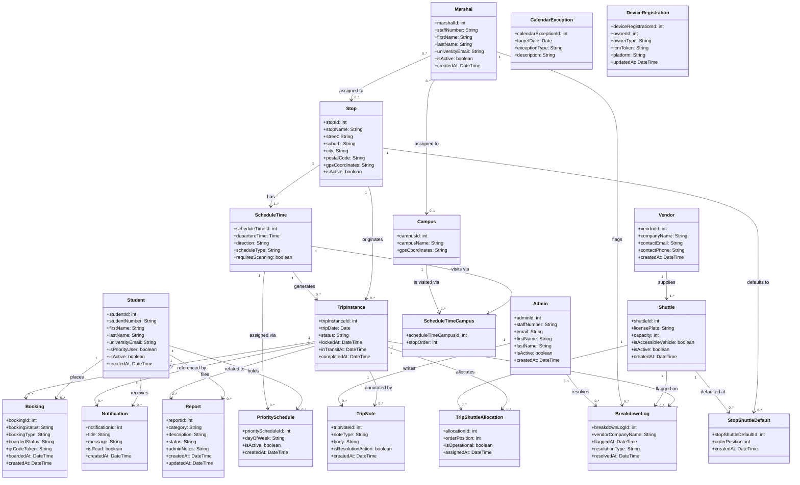

# 3. Data Requirements & Domain Class Modelling

---

## 3.1 Class Identification Methodology

The **Noun Technique** was applied to the use cases, system narratives, and the
implemented codebase to identify all domain classes. Each noun was evaluated against
two questions:

1. Is it a distinct, independent thing the system must store information about?
2. Does it have its own attributes, or is it merely an attribute of another class?

Nouns that passed both checks became domain classes. Nouns that described a property
of another class (e.g. "departure time" describes a `ScheduleTime`) became attributes.

---

## 3.2 Domain Entity Specification

All 20 domain classes identified in the implemented system are listed below with their
attributes. Identifiers (primary keys) are marked with `*`.

### User-type Classes

| Class | Attributes |
|-------|-----------|
| **Student** | `*studentId: int`, `studentNumber: String`, `firstName: String`, `lastName: String`, `universityEmail: String`, `isPriorityUser: boolean`, `isActive: boolean`, `createdAt: DateTime` |
| **Marshal** | `*marshalId: int`, `staffNumber: String`, `firstName: String`, `lastName: String`, `universityEmail: String`, `isActive: boolean`, `createdAt: DateTime` |
| **Admin** | `*adminId: int`, `staffNumber: String`, `email: String`, `firstName: String`, `lastName: String`, `isActive: boolean`, `createdAt: DateTime` |

> `OtpHash`, `OtpExpiry`, and `PasswordHash` are security/infrastructure fields excluded
> from the domain model under the Perfect Technology Assumption.

### Infrastructure Classes

| Class | Attributes |
|-------|-----------|
| **Stop** | `*stopId: int`, `stopName: String`, `street: String`, `suburb: String`, `city: String`, `postalCode: String`, `gpsCoordinates: String`, `isActive: boolean` |
| **Campus** | `*campusId: int`, `campusName: String`, `gpsCoordinates: String` |
| **Vendor** | `*vendorId: int`, `companyName: String`, `contactEmail: String`, `contactPhone: String`, `createdAt: DateTime` |
| **Shuttle** | `*shuttleId: int`, `licensePlate: String`, `capacity: int`, `isAccessibleVehicle: boolean`, `isActive: boolean`, `createdAt: DateTime` |

### Scheduling Classes

| Class | Attributes |
|-------|-----------|
| **ScheduleTime** | `*scheduleTimeId: int`, `departureTime: Time`, `direction: String`, `scheduleType: String`, `requiresScanning: boolean` |
| **ScheduleTimeCampus** | `*scheduleTimeCampusId: int`, `stopOrder: int` |
| **CalendarException** | `*calendarExceptionId: int`, `targetDate: Date`, `exceptionType: String`, `description: String` |
| **StopShuttleDefault** | `*stopShuttleDefaultId: int`, `orderPosition: int`, `createdAt: DateTime` |

### Operational Classes

| Class | Attributes |
|-------|-----------|
| **TripInstance** | `*tripInstanceId: int`, `tripDate: Date`, `status: String`, `lockedAt: DateTime`, `inTransitAt: DateTime`, `completedAt: DateTime` |
| **TripShuttleAllocation** | `*allocationId: int`, `orderPosition: int`, `isOperational: boolean`, `assignedAt: DateTime` |
| **Booking** | `*bookingId: int`, `bookingStatus: String`, `bookingType: String`, `boardedStatus: String`, `qrCodeToken: String`, `boardedAt: DateTime`, `createdAt: DateTime` |
| **PrioritySchedule** | `*priorityScheduleId: int`, `dayOfWeek: String`, `isActive: boolean`, `createdAt: DateTime` |

### Communication Classes

| Class | Attributes |
|-------|-----------|
| **Notification** | `*notificationId: int`, `title: String`, `message: String`, `isRead: boolean`, `createdAt: DateTime` |
| **DeviceRegistration** | `*deviceRegistrationId: int`, `ownerId: int`, `ownerType: String`, `fcmToken: String`, `platform: String`, `updatedAt: DateTime` |

### Incident Classes

| Class | Attributes |
|-------|-----------|
| **Report** | `*reportId: int`, `category: String`, `description: String`, `status: String`, `adminNotes: String`, `createdAt: DateTime`, `updatedAt: DateTime` |
| **BreakdownLog** | `*breakdownLogId: int`, `vendorCompanyName: String`, `flaggedAt: DateTime`, `resolutionType: String`, `resolvedAt: DateTime` |
| **TripNote** | `*tripNoteId: int`, `noteType: String`, `body: String`, `isResolutionAction: boolean`, `createdAt: DateTime` |

---

## 3.3 Association Analysis

Before drawing the diagram, each association is stated in both reading directions
with its multiplicity constraints.

| Association | Reading Direction 1 | Reading Direction 2 |
|---|---|---|
| Vendor ↔ Shuttle | A Vendor supplies one or many Shuttles | A Shuttle belongs to exactly one Vendor |
| Stop ↔ ScheduleTime | A Stop has one or many ScheduleTimes | A ScheduleTime departs from exactly one Stop |
| ScheduleTime ↔ Campus | A ScheduleTime visits one or many Campuses *(via ScheduleTimeCampus)* | A Campus is served by zero or many ScheduleTimes |
| Stop ↔ StopShuttleDefault | A Stop has zero or many default Shuttles | A Shuttle may appear in zero or many Stop defaults |
| Stop ↔ TripInstance | A Stop has zero or many TripInstances | A TripInstance departs from exactly one Stop |
| ScheduleTime ↔ TripInstance | A ScheduleTime generates zero or many TripInstances | A TripInstance is generated from exactly one ScheduleTime |
| TripInstance ↔ Shuttle | A TripInstance allocates one or many Shuttles *(via TripShuttleAllocation)* | A Shuttle may be allocated to zero or many TripInstances |
| Student ↔ TripInstance | A Student books zero or many TripInstances *(via Booking)* | A TripInstance has zero or many Student bookings |
| Student ↔ ScheduleTime | A Student may have zero or many PrioritySchedules | A ScheduleTime may have zero or many priority Students |
| Student ↔ Notification | A Student receives zero or many Notifications | A Notification belongs to exactly one Student |
| Student ↔ Report | A Student files zero or many Reports | A Report is filed by exactly one Student |
| Marshal ↔ Stop | A Marshal is assigned to zero or one Stop | A Stop has zero or many Marshals |
| Marshal ↔ Campus | A Marshal is assigned to zero or one Campus | A Campus has zero or many Marshals |
| Marshal ↔ BreakdownLog | A Marshal flags zero or many BreakdownLogs | A BreakdownLog is flagged by exactly one Marshal |
| Admin ↔ BreakdownLog | An Admin resolves zero or many BreakdownLogs | A BreakdownLog is resolved by zero or one Admin |
| Admin ↔ TripNote | An Admin writes zero or many TripNotes | A TripNote is written by exactly one Admin |
| TripInstance ↔ BreakdownLog | A TripInstance has zero or many BreakdownLogs | A BreakdownLog belongs to exactly one TripInstance |
| TripInstance ↔ TripNote | A TripInstance has zero or many TripNotes | A TripNote belongs to exactly one TripInstance |
| TripInstance ↔ Notification | A TripInstance is referenced by zero or many Notifications | A Notification optionally references one TripInstance |

> **Many-to-many associations with association classes:**
> - `TripShuttleAllocation` resolves the many-to-many between `TripInstance` and `Shuttle`. It carries `orderPosition` and `isOperational` — attributes that belong to the relationship, not to either class alone.
> - `Booking` resolves the many-to-many between `Student` and `TripInstance`. It carries `bookingStatus`, `boardedStatus`, `qrCodeToken`, and other attributes that describe the specific act of booking.
> - `PrioritySchedule` resolves the many-to-many between `Student` and `ScheduleTime`. It carries `dayOfWeek` and `isActive`.
> - `ScheduleTimeCampus` resolves the many-to-many between `ScheduleTime` and `Campus`. It carries `stopOrder` — the sequence in which the campus is visited on that route.
> - `StopShuttleDefault` resolves the many-to-many between `Stop` and `Shuttle`. It carries `orderPosition` — the default convoy position of that shuttle at that stop.

---

## 3.4 Domain Class Diagram

---

## 3.5 Key Design Decisions

### Five Association Classes

The domain contains five many-to-many relationships that each require an association
class because the relationship itself carries data:

| Association Class | Resolves | Why it needs its own class |
|---|---|---|
| `Booking` | Student ↔ TripInstance | Carries booking status, boarding status, QR token, and timestamps that belong to the act of booking — not to the student or the trip in isolation. |
| `TripShuttleAllocation` | TripInstance ↔ Shuttle | Carries convoy position (`orderPosition`) and operational status (`isOperational`). The same shuttle can be at different positions on different trips. |
| `PrioritySchedule` | Student ↔ ScheduleTime | Carries the day-of-week pattern and active flag — specifying on which days a particular student is pre-booked on a particular schedule. |
| `ScheduleTimeCampus` | ScheduleTime ↔ Campus | Carries `stopOrder` — the sequence in which a multi-campus route visits each campus. Without this, route ordering would be lost. |
| `StopShuttleDefault` | Stop ↔ Shuttle | Carries `orderPosition` — the standing convoy position of a shuttle at a stop. This is the template from which trip allocations are generated. |

### No Generalisation (Inheritance) in This Domain

The initial submission modelled `Student`, `Marshal`, and `Admin` as subclasses of a
`User` superclass. In the implemented system, these three entities are completely
separate tables with no shared base class. They share some attribute names (e.g.
`firstName`, `lastName`) but they differ significantly in their associations —
`Student` links to `Booking`, `PrioritySchedule`, `Notification`, and `Report`;
`Marshal` links to `BreakdownLog` and has a stop/campus assignment; `Admin` links to
`BreakdownLog` (resolver) and `TripNote`. Forcing a superclass here would obscure
these differences and add no modelling value. They are modelled as independent classes.

### Marshal Assignment XOR Constraint

A `Marshal` is assigned to **either** a `Stop` **or** a `Campus` — never both, never
neither. This is an exclusive-or (XOR) constraint. On the class diagram, both
associations are shown with `0..1` multiplicity on the Stop/Campus side to reflect
that each link is optional in isolation, with the understanding that exactly one must
be populated. This constraint is enforced at the API layer.

### Vendor Name Denormalisation in BreakdownLog

`BreakdownLog` stores `vendorCompanyName` as a copied string rather than only a FK to
`Vendor`. This is an intentional design decision: if a shuttle's vendor changes after
a breakdown is logged, the analytics data must still reflect who owned the vehicle at
the time of the incident. Denormalisation preserves historical accuracy.
