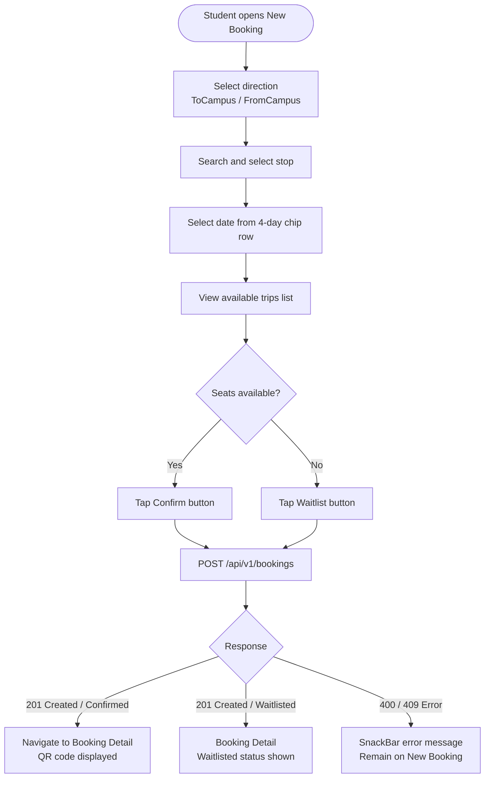
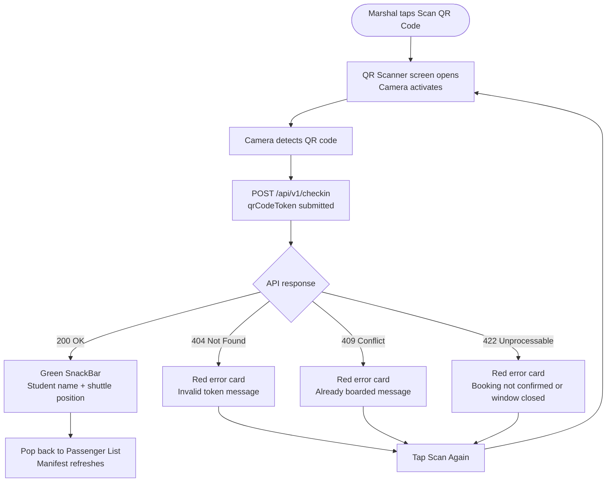
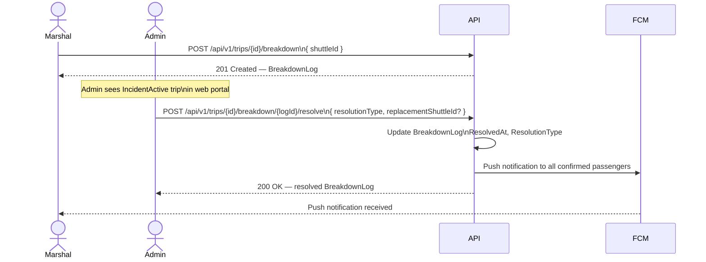

# 4. Interface Guidelines & Design System

---

## 4.1 Design System Constants

The design system is implemented in `AppTheme` (AppUI) and replicated inline in
the web portal. Both platforms use the same brand constants and typography.

### Brand Colours

| Token | Hex | Role |
|-------|-----|------|
| `primaryGold` | `#FFCC00` | Primary action colour. Used for FABs, selected tabs, active chips, CTA buttons, and the marshal "Next Boarding" card background. |
| `navy` | `#132E51` | Text, icon, and container colour. Used as the `onPrimary` colour so white text always gives way to navy on gold. |
| Background (light) | `#FFFFFF` | Scaffold and card background in light mode. |
| Background (dark) | `#121212` | Scaffold background in dark mode. Surface cards use `#1E1E1E`. |
| Admin portal background | `#F5F5F5` | Distinct off-white surface used across all web portal pages to create card lift. |

### Typography

- **Font family:** Hanken Grotesk, loaded via the `google_fonts` package.
- Applied globally through `GoogleFonts.hankenGroteskTextTheme()` in `ThemeData`.
- No other font families are used. Font weights used in practice: 400 (regular),
  500 (medium), 600 (semi-bold), 700 (bold).

### Material Design Version

- Material 3 (`useMaterial3: true`) on both platforms.
- `ColorScheme` is defined explicitly — primary = gold, secondary = navy, surface =
  white, onSurface = navy.
- No Tailwind, no CSS, no external UI library. All styling is native Flutter.

---

## 4.2 Navigation Patterns

### Mobile App (Student & Marshal)

**No AppBar.** The top of every screen is unobstructed. Navigation is driven by:

1. **Floating hamburger button (top-left)** — a `Positioned` widget placed above the
   page content with `Material(color: Colors.white)` background and
   `BorderRadius.circular(8)`. Tapping opens a side `Drawer`.

   ```
   Position: top: (statusBarHeight + 12), left: 16
   Size:      padding = 10 on all sides (icon 24×24)
   Shape:     BorderRadius.circular(8), white background, no shadow
   ```

2. **Drawer sidebar** — contains links to all sections for the active role.
   The Logout button is pinned to the bottom using a `Column` with `Spacer`.

3. **`go_router` for declarative routing** — all navigation uses `context.push()`
   or `context.go()`. Back navigation uses a `FloatingBackButton` widget,
   similarly positioned top-left, replacing the system back button visually.

4. **Tab bar (Student Home)** — `TabController` with 2 tabs ("Upcoming", "Past").
   Active tab uses a gold `BoxDecoration` indicator filling the full tab width,
   text colour navy. Inactive text is `Colors.grey.shade600`.

5. **Bottom navigation** — used on the student shell for top-level switching
   between Home, Maps, Alerts, and Profile.

### Admin Web Portal

- Persistent left sidebar navigation (not a drawer — always visible on desktop).
- No hamburger button. Sections: Overview, Stops, Shuttles, Vendors, Users,
  Schedule, Trips, Reports.
- Background is `#F5F5F5`; content panels are white `Container` cards with
  `BorderRadius.circular(16)` and a subtle box shadow
  `(color: black 5%, blurRadius: 10, offset: Offset(0,2))`.

---

## 4.3 Screen Inventory

### Mobile App — Student Role

| Screen | Route | Purpose |
|--------|-------|---------|
| Login | `/login` | OTP email entry → OTP code entry (two-step). |
| Student Home | `/student/home` | Upcoming / Past bookings tab view. FAB → New Booking. |
| New Booking | `/student/booking/new` | Direction toggle, stop search, 4-day date chips, trip list with capacity. |
| Booking Detail | `/student/booking/:id` | QR code display (with NMU logo embedded), booking info, cancel & report buttons. |
| Alerts | `/student/alerts` | Notification list. |
| Alert Detail | `/student/alerts/:id` | Full notification content. |
| Report Form | (modal push) | Category + description form for submitting an issue. |
| Report Detail | (modal push) | Status view of a previously submitted report. |
| Maps | `/student/maps` | Stop location finder. |
| Profile | `/student/profile` | Student info and settings. |

### Mobile App — Marshal Role

| Screen | Route | Purpose |
|--------|-------|---------|
| Login | `/login` | Shared with Student. Role is determined from JWT claims. |
| Marshal Home | `/marshal/home` | Assigned location header, "Next Boarding" gold card, remaining schedule list, Scan QR + Get Directions buttons. |
| Passenger List | `/marshal/passengers/:tripId` | Full manifest for a trip — total confirmed, boarded, pending counts; per-passenger rows. |
| QR Scanner | (push from Passenger List) | Live camera scanner. Scan frame border turns red on error, gold when idle. Inline error card with "Scan Again" button. |

### Admin Web Portal

| Screen | Section | Purpose |
|--------|---------|---------|
| Login | `/login` | Two-step OTP login (email → 5-digit OTP). |
| Overview | `/overview` | Dashboard: most/least demand stops, reports summary, breakdown & cancellation analytics with vendor reliability table. |
| Stops | `/stops` | List all stops. Create, edit, deactivate. Stop detail with trip history. |
| Shuttles | `/shuttles` | List all shuttles. Create, edit, toggle active. |
| Vendors | `/vendors` | List vendors. Create, edit. |
| Users | `/users` | List students and marshals. Import students via CSV. Create/edit/deactivate. |
| Schedule | `/schedule` | Manage schedule times and campus-route mapping. |
| Calendar | `/calendar` | Add and remove calendar exceptions (public holidays, recesses). |
| Priority Schedules | `/priority` | Manage per-student recurring priority booking slots. |
| Trips | `/trips` | Browse trip instances by date/stop. Trip detail with convoy and breakdown view. |
| Reports | `/reports` | View submitted student reports. Update status and add admin notes. |

---

## 4.4 Key Component Patterns

### QR Code — Booking Detail

The QR code renders using the `qr_flutter` package via `QrImageView`. The encoded
value is the `qrCodeToken` string from the booking. The NMU logo is embedded at the
centre using `embeddedImageStyle: QrEmbeddedImageStyle(size: Size(48, 48))`.

The entire QR widget is wrapped in a `RepaintBoundary` so the screenshot-to-gallery
download captures only the code without the surrounding page chrome.

```
QrImageView:
  data:          booking.qrCodeToken
  size:          256 × 256
  embeddedImage: AssetImage('assets/logos/qrImg.png')
  embeddedSize:  48 × 48
  background:    white Container, BorderRadius.circular(16), padding 16
```

### QR Scanner — Marshal

The scanner uses `mobile_scanner` with `CameraFacing.back` and
`DetectionSpeed.normal`. A centred `280×280` overlay frame indicates the scan zone.
The frame border colour is:

- `AppTheme.primaryGold` — idle / ready to scan
- `Colors.red` — error state (invalid or already-boarded token)

On success: green `SnackBar` with student name and shuttle position, then pops back
to the passenger list. On failure: an inline red card at the bottom of the screen
with the server error message and a "Scan Again" `FilledButton` (background: navy).
The scanner resets `_hasScanned = false` after an error, allowing an immediate retry.

### Trip Availability Card (New Booking)

Each trip in the booking list is a zero-elevation `Card` with `BorderRadius.circular(12)`.
Left section: a navy-tinted time container. Right section: campus name and seat count.
Far right: the action button.

| State | Button Label | Background | Foreground |
|-------|-------------|------------|------------|
| Seats available | Confirm | `primaryGold` | navy |
| Full (waitlist) | Waitlist | `Colors.orange.shade100` | `Colors.orange.shade800` |
| Loading | *(disabled)* | gold (50% opacity) | — |

### Status Chips (Marshal & Booking)

Trip and booking status values are displayed as `Container`-based coloured chips —
not Flutter `Chip` widgets — for precise colour control:

| Status | Background | Text colour |
|--------|-----------|-------------|
| Scheduling | `Colors.grey.shade100` | `Colors.grey.shade700` |
| Locked | `Colors.orange.shade100` | `Colors.orange.shade800` |
| InTransit | `Colors.blue.shade100` | `Colors.blue.shade800` |
| IncidentActive | `Colors.red.shade100` | `Colors.red.shade800` |
| Completed | `Colors.green.shade100` | `Colors.green.shade800` |
| Confirmed (booking) | — | `Colors.green` |
| Waitlisted (booking) | — | `Colors.orange` |
| Cancelled (booking) | — | `Colors.red` |

---

## 4.5 Key Flow Diagrams

### Student Booking Flow (S100 → S110)



### Marshal Check-in Flow (M110 → M120)



### Breakdown Resolution Flow (M200 → A400)



---

## 4.6 Accessibility & Outdoor Usability Notes

The design system was specifically shaped around outdoor use at shuttle stops:

- **High contrast ratio.** Navy (`#132E51`) on gold (`#FFCC00`) and navy on white are
  both WCAG AA compliant for normal text. The large departure time text (36sp, bold)
  on the marshal home card ensures readability in direct sunlight.
- **Large touch targets.** Key action buttons (Scan QR Code, Confirm booking) use
  `height: 56` with full-width layout, well above the 48dp minimum.
- **Colour is never the sole indicator.** Status chips combine colour with text labels.
  The scanner uses a border colour change **plus** an inline error card with text.
- **Error messages are inline, not toast-only.** On the scanner screen, errors appear
  as persistent cards rather than auto-dismissing snackbars, giving marshals time to
  read the reason in noisy outdoor environments.
- **QR screenshots are explicitly supported.** The booking detail screen includes a
  "Download QR Code" button, acknowledging that students may be offline at boarding
  time. The system business rules also accept saved QR screenshots.
